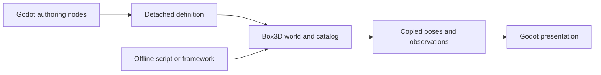

# Physics ownership

Give each Box3D world one tick owner, and keep source content and presentation
separate from its mutable solver. This applies to offline scripts, Kit, and Replay.

## Four different kinds of data

| Data | Owner | Lifetime |
| --- | --- | --- |
| Authored nodes and Resources | Godot scene/editor | Needed while extracting initial content |
| Detached baked definition, catalog, and mappings | The code that creates them | Survive source scene destruction; release with their authoring APIs |
| Live solver and complete checkpoints | Offline script or selected framework adapter | Must outlive stepping, retained history, and dependent readers |
| Mesh nodes, debug geometry, animation, audio | Presentation | Read copied values after accepted simulation work |

Source nodes describe initial state. They do not schedule physics. A detached
bake owns copied data, so its native construction can outlive the original scene.
Native handles remain local runtime identities and never become durable game IDs.

## Choose one tick owner

An offline script can call `world_step_fixed` from `_physics_process`. Kit's Lane
and Replay's runtime own their respective simulation loops. When an adapter owns
the world, use that adapter's step contract; do not also step it from a Godot
physics callback.

Keep gameplay values that affect physics in rollback-owned state. Kit uses Side
and tracked fields; Replay uses typed frame values and a managed solver
attachment. Character position, velocity, jump state, timers, and pending actions
must return to the same tick as the solver.

## Preserve complete state for replay

A collection of body poses omits contact caches, constraints, and pending
contact/sensor events. Use complete adapter checkpoints for correction and
recovery. Diagnostic pose or motion hashes are insufficient for complete state
equality. Compatibility also includes build, target, content, and schema.

Defer audio, scene mutation, and other external effects until a simulation
transaction is accepted. Use stable effect identities so replay can recognize
an already presented result.

## Close dependent owners first

Stop frame work, close network/session bindings, and release retained checkpoints
before their provider, catalog, allocator, and native world owners. Follow the
selected adapter's transfer rules: copying an owning struct can alias ownership.
Check destruction results; if a drop declines, the remaining owner still needs
cleanup.

Desktop modules share one loaded native backend. Stop Godot before replacing
that backend; script reload and native-library replacement have different
lifetimes. See [Build and export](building.md).
