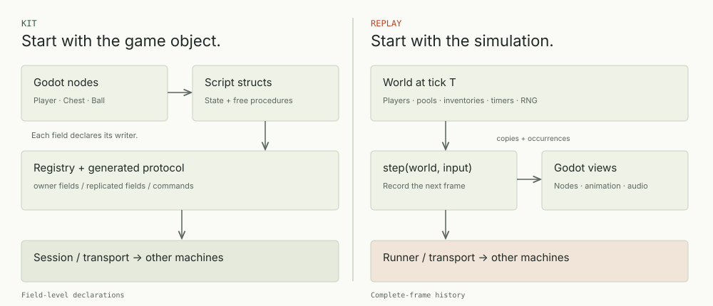

# Choosing Kit or Replay

Choose the framework that matches where your gameplay state lives. Both run on
the Odin and Godot bridge, and both support cooperative sessions and authoritative
prediction. Kit and Replay have independent runtime owners and protocols.

Complete [your first Odin scene](../scripting/first-scene.md) before either
multiplayer tutorial.

## Compare the models

| Decision | Kit | Replay |
| --- | --- | --- |
| Mutable gameplay | Script entity fields, optionally advanced by the simulation lane | A typed World containing state needed to compute the next tick |
| Declarations | Replicated, owner-written, and predicted fields; commands and events | World, input, step procedure, occurrences, and runtime policy |
| Shared interactions | Commands mutate a target; accepted cross-entity consequences run on the authority | A step changes several entities in the same restorable state |
| Prediction | Target commands and fixed-tick predicted fields | Input prediction and restoration of the complete simulation group |
| Godot presentation | Registered entities and presentation fields | Copied frames and occurrence changes |
| Physics | Cooperative Godot body streaming, or `kit/physics` for Box3D | Cooperative owner observations, or `replay/physics` for Box3D |
| First tutorial | [Two moving players](../kit/quickstart.md) | [Correct an inventory transfer](../replay/quickstart.md) |

## Kit and script entities

Kit fits a game organized around Godot script entities. Tag a field with its
writer, register an entity, and use commands for interactions. Start with session
replication for cooperative movement. Move contested state to the simulation
lane when the authority must compute it.

Owner-streamed motion trusts the player providing it. Competitive play needs
server-authoritative simulation, validated input, and a trusted authority. Read
[Kit profiles](../kit/profiles.md) before exposing a session publicly.

## Replay and restorable gameplay

Replay fits a game whose rules operate on explicit value state. A World includes
positions, inventories, cooldowns, RNG, and entity lifetime. Replaying corrected
input restores those dependencies together. Godot nodes display the result and
handle animation and effects outside the simulation.

Device reads, scene references, and irreversible effects cannot live inside a
replayed step. History consumes memory and correction consumes CPU. Replay
remains experimental; consult [support](../replay/support.md) before choosing a mode.

## Keep the physics decision separate

Box3D is optional for both frameworks and also works offline. Godot body
streaming is useful for trusted co-op; restoring body poses alone does not
restore the contact solver for deterministic replay.

Box3D's framework adapter retains complete physics state and the framework owns
stepping. Read [Physics ownership](../box3d/ownership.md) before connecting it to multiplayer.
