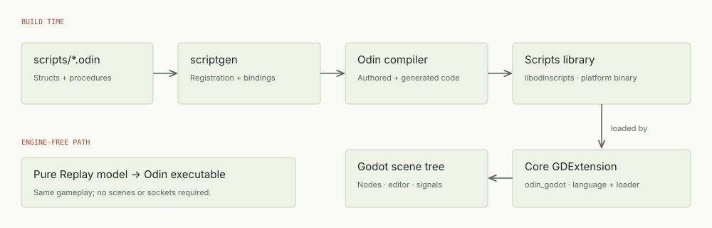

# Odin and Godot

Use the scripting bridge to write compiled Odin gameplay inside an ordinary
Godot project. This is the foundation for the other SDK packages and is enough
for a single-player game. Multiplayer and Box3D are optional.

You should know how to create a Godot scene, attach a script, and run a project.
For Odin syntax, keep the [Odin overview](https://odin-lang.org/docs/overview/)
nearby; the tutorial explains the script conventions specific to this SDK.

## How a script runs

Each script declares a struct for its instance data and free procedures for its
behavior. The first field, `owner`, holds its Godot object. For a node script,
`self` points to the script data and `self.owner` refers to the scene node. Godot
calls procedures such as `mover_ready` through generated registration.

The core GDExtension adds the Odin language to Godot. Gameplay compiles into a
separate scripts library. Saving a script can rebuild and reload that library;
changes to exported properties also require compilation.

## Learn the bridge

Use the [API reference](../api/index.md) to look up exported types and functions,
including the [Godot helper layer](https://wlitwin.github.io/odin_godot/api/generated/godot.html).

| Read | What you will learn |
| --- | --- |
| [Your first Odin scene](first-scene.md) | Create a project, compile a script, expose a speed property, and move a visible node |
| [Installation and project wiring](../getting-started.md) | Configure the toolchain, extension manifest, compiler path, and SDK root |
| [Script model](../onboarding/02-thinking-in-structs.md) | Map Godot objects and GDScript patterns to Odin state and procedures |
| [Development workflow](../workflow.md) | Build, reload, organize code, and use editor completion |
| [Debugging](../debugging.md) | Diagnose build failures and inspect native crashes |
| [Script modules](../modules.md) | Split large projects into independently built libraries |
| [Exporting](../exporting.md) | Compile and package desktop and web releases |
| [Authoring reference](../authoring-guide.md) | Look up markers, field tags, callbacks, methods, signals, resources, and engine helpers |

## Limits

Scripts compile ahead of time. There is no script REPL or Godot script-line
debugger; use native debugging tools for breakpoints. Runtime and compiler ABI
compatibility matter when distributing the addon. See
[Distribution](../distribution.md) for toolchain and platform requirements.

## Next

Build [your first scene](first-scene.md). Once it runs, explore
[libraries](../libraries/index.md), [multiplayer](../multiplayer/index.md),
or [Box3D](../box3d/index.md).
