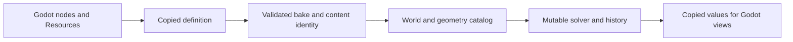

# Authoring and world identity

An authored scene describes how to construct a physics world. A running world
owns the mutable solver created from that description. Keeping those roles
separate lets you rebuild levels, retain checkpoints, and connect multiplayer
peers without tying saved gameplay to Godot node addresses.

This page explains the design behind [world authoring](../authoring.md). It
also helps diagnose a world that looks correct in the editor but is rejected
as incompatible at runtime.

## Treat the scene as construction data

Imagine a warehouse level containing static ramps, several cargo bodies, a
pendulum, and delivery sensors. The authoring nodes and shape Resources hold
its initial definitions. Extraction copies those definitions into detached
data. Baking validates and resolves geometry and identity; construction creates
the native world and its local mappings.

The Godot extractor returns the baked scene used by the builder. Lower-level
callers can instead provide explicit Odin authoring input to the baker.

The original scene can then leave memory while the detached definition or
constructed world continues to exist. Changing an authoring Resource does not
mutate an already-created world. Decide whether a change belongs in the next
level build or is a runtime operation applied by the current tick owner.

A Godot mesh is also independent of this construction data. You can replace a
crate's visual model while preserving its collision description. Editing the
physics shape's dimensions, density, or filter changes simulation content and
must be treated accordingly.

## Bake the geometry you intend to simulate

The authoring pipeline accepts rigid body/world poses and supported positive
shape scale. Spheres and capsules require uniform scale. A rotated or offset
box can bake into an exact convex hull rather than quietly losing its local
transform. Unsupported shear, reflections, or dimensions produce diagnostics.

Choose collision geometry for the physical role. A collection of simple convex
shapes can represent a movable load. Triangle meshes and heightfields provide
static, non-sensor level collision. Their restrictions matter when deciding
whether a detailed warehouse model should be movable cargo or a static wall.

Rendering detail and collision detail have different costs. Bolts in a mesh
need not become individual solver shapes unless they change gameplay. Start
with the simplest collision description that preserves the interactions the
player must understand, then inspect it with the [editor tools](../editor.md).

## Distinguish four identities

Several identifiers can refer to related objects while answering different
questions:

| Identity | Question it answers | Example |
| --- | --- | --- |
| Authored logical ID | Which authored object is this? | The body's namespace and explicit stable key identify the pendulum |
| Content identity | Which physics definition is this? | Geometry, poses, materials, filters, and flags match the expected level |
| Catalog asset ID | Which immutable baked geometry is reused? | Many crates share one geometry asset |
| Native allocation key or handle | Which runtime allocation does this operation address? | A joint resolves its current bodies in this world's history |

Authored logical IDs derive from explicit namespace and keys. A shape's identity
also relates it to its body. Reordering scene children should not rename the
objects' meaning. Renaming an ordinary presentation node can leave identity
unchanged when the explicit keys and relevant authored transforms stay the same.

Changing a key or namespace is an identity change. A saved game that refers to
the old logical object needs an application-defined migration or a rejection
rule. Reusing a key for a different gameplay role does not perform that
migration automatically.

Native handles and allocation keys serve a shorter lifetime. Destruction,
restore, or an alternative replay branch can invalidate or reuse their numeric
values. Store the game's entity lifetime and mappings with its restorable
state; resolve the current native allocation when executing an operation.

## Share geometry without merging objects

Two crates can share a geometry catalog asset while retaining distinct bodies,
authored keys, materials, and gameplay ownership. Deduplication reduces repeated
immutable geometry; it does not make the crates share position or velocity.

The authoring pipeline keeps authored resource identity and catalog geometry
identity separate. Reusing a resource key requires its baked geometry to agree.
Duplicate body keys, conflicting resource definitions, unresolved joint
references, and identifier collisions are errors that need a content decision.
Skipping the conflicting object can leave different peers simulating different
levels.

This distinction also explains the separate [capacity fields](../capacities.md).
Body count, shape count, and deduplicated asset count measure different things.
A compound body uses several shapes; a thousand instances can share a small
set of assets while still requiring separate solver and history state.

## Keep compatibility explicit

Two builds can render the same scene while using different friction, collision
masks, geometry, or solver configuration. Multiplayer physics needs agreement
on the data that determines future ticks. The complete-state protocols bind
build/target identity, content, and framework schemas rather than judging
compatibility from the picture.

A capacity profile is also part of the backend build. Its fixed buffers and
admission bounds must match the Odin modules and authoring addon. The SDK
builder propagates a selected profile; follow [Configure capacities](../capacities.md)
when changing it. A larger quota does not convert an older checkpoint or make
a different target's solver interchangeable.

Desktop modules share one loaded backend. Stop Godot before replacing it and
rebuild the matching modules. Retained worlds and checkpoints depend on their
originating code, geometry, catalogs, and allocators, so script reload and
backend replacement have different lifetime rules.

For a concrete reading exercise, trace one cargo body from its `stable_key`
through the detached mappings to the runtime body key. Then compare what changes
when you alter its visual material, its physics friction, and its stable key.
Those are three different changes with different compatibility consequences.
