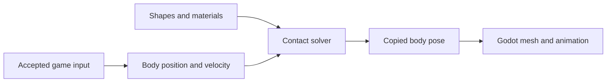

# Bodies, shapes, and motion

A physics object combines rules for motion with a collision shape. Its visible
mesh is another object again. Understanding those roles helps you choose how a
crate, lift, ball, or player should move before adding multiplayer.

This page assumes you can run [the tower example](../quickstart.md). The native
Odin package is `godot:box3d`; Godot's own `RigidBody3D` and `CharacterBody3D`
continue to use Godot physics unless you explicitly integrate them with Box3D.

## Separate the object you draw from the object you simulate

A **body** owns position, rotation, velocity, and its motion type. A **shape**
describes collision geometry attached to that body, together with material and
filter settings. One body can have several shapes. A **view** is the mesh,
animation, or other Godot node that displays copied simulation results.

Imagine a trolley built from a visible model and three box shapes. The three
shapes move as one rigid body; they are not three objects that must be kept in
sync by joints. The mesh can have decorative handles and cables without giving
each decoration collision geometry.

Moving the mesh changes what the player sees. It leaves the Box3D body where it
was. Moving a body and then writing a different transform to its mesh gives the
player two inconsistent accounts of the same object: visible contact can happen
before the solver sees contact, or a ray can hit apparently empty space.

## Choose who determines motion

Body type determines how the solver treats motion and incoming impulses.

| Type | Motion comes from | Typical use |
| --- | --- | --- |
| Static | Authored placement | Floors, walls, fixed level geometry |
| Kinematic | Game-prescribed motion, such as velocity | A lift or moving obstacle that follows a rule |
| Dynamic | Velocity, gravity, impulses, and contact response | Cargo, balls, falling debris |

A dynamic crate can be pushed out of the way. A kinematic lift follows its
prescribed movement while interacting with dynamic bodies; a crate does not
choose the lift's route by hitting it. Static bodies describe stationary
collision. Ordinary rigid-body contacts require at least one dynamic body, so
two prescribed or stationary bodies do not behave like two dynamic crates.

Choose the type from the gameplay rule. A door that must swing when struck may
be a dynamic body attached by a hinge. A door that opens to a specified position
on a timetable may use prescribed motion. A purely decorative door needs no
physics body. The same visual model can support all three designs.

## Give scale and mass a consistent meaning

The managed integration uses meters in a Y-up, right-handed world. A rigid pose
contains position and rotation. Shape dimensions and supported shape scale
describe size; scaling the rendered node is a separate presentation choice.

For a dynamic body, shape volume and density determine mass. Increasing a box's
dimensions changes more than its appearance: it changes its collision surface,
mass, and rotational response. Doubling a uniform density doubles mass while
leaving the collision surface in place. The tower tutorial uses that distinction
to compare a heavy projectile with a lighter projectile of the same radius.

Use plausible relative sizes and masses for the interactions that matter to
the game. A small robot trying to drag a massive load will need a different
control rule from one pushing a lightweight crate. Raising a speed setting
cannot resolve a contradictory mass or constraint setup.

## Distinguish an impulse from a prescribed velocity

An **impulse** changes momentum at a particular simulation boundary. Ignoring
other forces and contacts, an impulse of 4 kg·m/s applied to a 2 kg body changes
its linear velocity by 2 m/s. Apply it at the center of mass for a linear push;
an off-center application can also rotate the body. The SDK exposes both a
center-of-mass impulse and an explicit world-space application point.

A sustained force represents a rate of momentum change. When implementing a
force-like control with the SDK's impulse surface, the impulse for each fixed
tick must account for that tick's duration. Repeating the same impulse once per
rendered frame makes the result depend on display frame rate.

Setting velocity expresses a different rule: the game requests a velocity
directly. Replacing it every tick can overwrite a collision response that the
solver just computed. That can be appropriate for a deliberately controlled
object, but it affects how pushes, friction, and impacts feel. Decide which
parts of motion the player controls and which parts the solver may preserve.

Setting a pose changes placement directly. Treat a teleport, respawn, and
ordinary movement as distinct game operations. A direct pose write does not
express a request to travel through every point between the old and new poses.
Use a [query or movement cast](collision-and-queries.md) when the path matters.

Fast projectiles also need a deliberate collision design. A small object can
travel a substantial distance during one tick, particularly relative to a thin
wall. Continuous-collision and bullet settings influence the solver's handling
of fast motion; they do not turn a direct pose write into a swept movement
request. Compare a simulated projectile with an explicit ray or cast when
deciding how a weapon should detect its hit.

## Put motion changes in the simulation

An offline world can apply its inputs and advance at a fixed physics tick.
Kit and Replay place those operations inside their respective staged physics
callbacks. Rendering then reads the accepted or selected predicted pose. A
visual animation can lean a robot or shake cargo without changing the saved
body pose that determines contacts.

Body sleep is also simulation state. Sleeping objects avoid ongoing active
simulation work, while appropriate interactions can wake them. Repeatedly
resetting poses or waking every object from render code defeats that behavior
and introduces a second source of motion.

When comparing two movement designs, observe the same push with different
render frame rates, inspect the body's mass, and compare its copied pose with
the visible mesh. Those observations help separate a control-rule problem from
a presentation problem.

Continue with [collisions and queries](collision-and-queries.md), or read
[joints and character movement](joints-and-characters.md) when selecting a
player or vehicle model.
