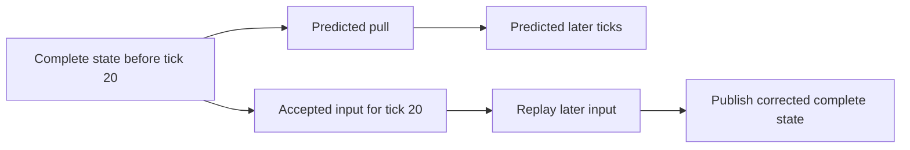

# Physics ticks and rollback

Restoring physics means restoring enough state to compute the next tick again.
Body transforms are one part of that state. This matters when a multiplayer
game predicts interactions, corrects accepted input, or recovers a session from
a checkpoint.

Start with [bodies and motion](bodies-shapes-and-motion.md) if Box3D is new to
you. Kit and Replay provide separate adapters for complete physics history;
their networking and runtime owners remain independent.

## A pose describes what you can see

Two crates can have the same position and rotation while having different
velocities, sleep state, contact caches, or constraints. Those differences can
change the next step. A pending sensor-end observation can also change the
next gameplay result even when the current picture looks identical.

Consider a predicted pull at tick 20. A client moves one crate into another,
which changes contact response for both. The authority later rejects the pull.
Putting the first crate back at its earlier position leaves the second crate's
motion and the solver's contact state unresolved. Correction needs a coherent
predecessor for the interaction, followed by the accepted input sequence.

Complete state pairs the solver with the game values that influence it:
entity membership, body mappings, timers, input-dependent movement state, RNG,
and relevant observations or occurrences. A physics image paired with game
state from another tick does not describe a coherent point in the game.

## Give each world one clock owner

The managed Box3D integration advances at 60 Hz with four substeps. Each tick
represents 1/60 second of game time. Four substeps divide the solver's work
inside that tick; they do not give game input four independent network ticks.

| Use | Tick owner | Physics work |
| --- | --- | --- |
| Offline example | The Odin script's physics loop | One `world_step_fixed` per scheduled tick |
| Kit complete-world integration | Kit Lane | The participant advances its staged world |
| Replay complete-world integration | Replay runtime and game step | The callback performs exactly one `replay/physics.step` |

Rendering can run faster or slower than simulation. A 120 Hz display does not
turn the fixed simulation into a 120 Hz world. The offline tower's
one-call-per-physics-frame schedule relies on Godot being configured for 60 Hz.
Other offline schedules need an explicit policy for accumulating elapsed time.
The managed adapters keep their existing fixed-step contract.

Stepping the same world again from a Godot callback introduces a second clock.
The framework may then capture “tick 20” after the solver has advanced twice,
while its input and game values advanced once. Moving a render node back cannot
repair that mismatch.

## Run a candidate before publishing it

Correction can execute a tick more than once. The adapter prepares a staged
world and matching gameplay state, applies the accepted operations, and checks
the candidate before publishing it. Queries inside that work must read the
staged world so a magnet, grounding test, or explosion sees the same branch
that the step is changing.

Several common game values therefore need explicit owners:

| Value | Where it belongs |
| --- | --- |
| Crate velocity and contact state | Complete physics state |
| Magnet target, cooldown, and cargo status | Restorable game state |
| Character grounding and jump timing | Kit Side or Replay frame values |
| Mesh node, camera smoothing, sound instance | Presentation |

Device reads and scene changes belong outside replayed simulation. Sample input
for the appropriate tick, run the model with those values, and update Godot
from copied results. Presentation can revise a predicted effect when correction
changes its gameplay cause; see [effects across correction](../../multiplayer/concepts/presentation-and-effects.md).

## Preserve the interaction group

Contacts and joints connect bodies' futures. Predicting a crate while treating
another colliding crate as an unrelated visual object leaves out a dependency.
The complete-world adapters retain the Box3D world together so those
dependencies return to the same predecessor.

Choose separate physics worlds when the game can genuinely simulate them
independently. Objects in separate solvers do not acquire cross-world contacts
because their meshes overlap. Similarly, camera visibility alone cannot decide
whether a body is needed for prediction: an off-screen mechanism can still
push an object that reaches a player. This is one reason
[performance and scale](../../multiplayer/concepts/performance-and-scale.md)
need a simulation budget as well as a rendering budget.

## Budget history and correction separately

The current complete-state integrations retain 128 ticks of history. Kit's
prediction and ordinary repair window is up to eight ticks. Replay defaults
to 30 predicted ticks and permits up to 32; its synchronous repair follows the
active runner window. These windows serve different policies, so the same
history length does not make the two protocols interchangeable.

More bodies, shapes, contacts, and joints increase the state that each retained
image can own and the work required to resimulate a suffix. A count allowance
of 1,024 bodies says how much the configured integration admits. It does not
set a frame-time budget for an arbitrary arrangement of those bodies.

Use [capacity profiles](../capacities.md) for storage and admission limits, and
measure ordinary ticks, correction, capture, transfer, and reconstruction with
the game's content. When predecessor history is missing, follow the framework's
explicit recovery path instead of substituting the current solver.

Exact physics peers use the same build and target, with compatible content and
schema. Follow
[support](../support.md) and [world identity](authoring-and-world-identity.md)
when distributing backends or changing authored content.
