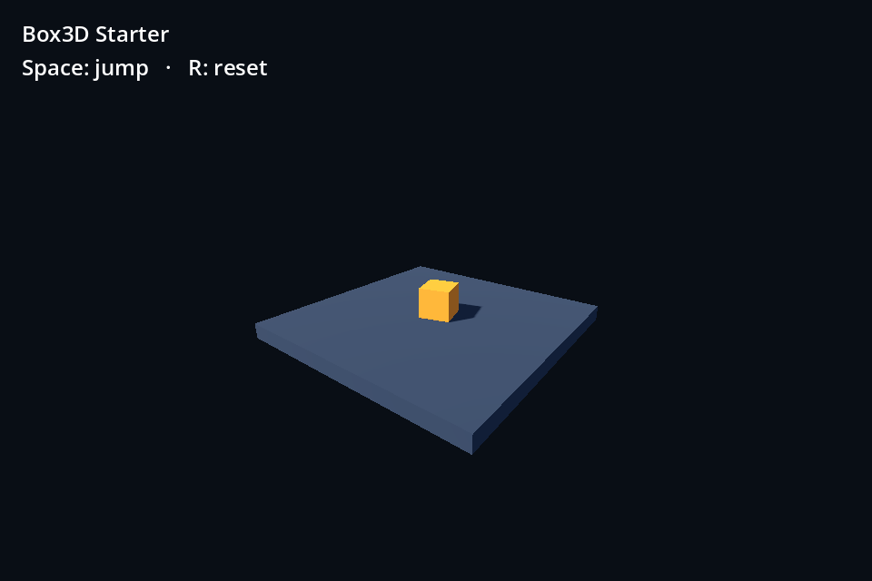

# Make a small offline physics game

Start with an editor-authored crate and floor. The Odin script owns one physics
scene; the framework binds its bodies to their visual nodes. Kit and Replay are
optional.



## 1. Open the starter

With an installed SDK, copy the contents of
`addons/odin_godot/template/box3d` into a new project containing the SDK's two
addon directories. Build and select your native backend once using
[Build and export](building.md), then open `main.tscn` and press **F6**.

From the source checkout, the convenience command performs the initial setup:

```sh
nix develop --command bash examples/box3d_starter/play.sh --editor
```

The crate drops onto the floor. **Space** makes it jump; **R** resets it.
Successful builds remember the compiler and backend, so later Project Manager
launches use **Build Odin Scripts** and normal save-time rebuilding.

## 2. Change the scene

Open `content/world.tscn` and select **Crate**. Move it higher or rotate it.
In its shape Resource, change friction, restitution or density. Its **Visual**
child supplies appearance; its shape Resource supplies collision. Keep their
dimensions consistent.

Select a body and choose **Install tools and build** to enable collision
previews and **Validate physics**. Runtime physics does not require this editor
module.

Use **Duplicate Box3D selection** to add another crate, move it apart from the
first, then play. The new crate receives a saved ID and automatically gets a
physics body and visual binding. The Space action still targets the original
Crate node.

## 3. Read the game loop

Open `scripts/game.odin`. These are the ownership operations:

```odin
import physics "godot:box3d/godot/scene"

// In ready: capture the initial World and bind its authored bodies.
self.scene, problem = physics.open(self.world)

// In physics_process: advance exactly one configured fixed step and show it.
problem = physics.step_fixed(&self.scene)

// On reset: restore captured content, including original positions.
problem = physics.reset(&self.scene)

// In finalize: release native ownership before releasing its copied data.
status := physics.destroy(&self.scene)
```

The complete script checks each diagnostic, reports actionable errors and stops
stepping on failure. `body_for_node` resolves a current handle when gameplay
needs to apply an impulse, including after reset.

The helper keeps an immutable initial bake. Reset does not extract the moved
nodes again. Temporary tree exit/re-entry preserves the owner; finalization
handles node destruction and script removal even outside the tree. A failed
open or reset still leaves a destroyable owner.

Body poses are published relative to the current World frame in hierarchy order.
Mesh-child offsets and scale stay unchanged. Nested Worlds are separate scopes;
removing a bound node or changing its body ancestry reports an error before the
next step. Use the lower-level API for runtime spawning or custom ownership.

The project uses 60 physics ticks per second, matching the default Box3D timing
profile. If you select another profile, set the Godot rate to match. The helper
reports a mismatch instead of changing global engine timing.

## 4. Export normally

Use **Project → Export** with the supplied **macOS arm64** or **Linux x86_64**
preset and a matching native backend. The standard Odin exporter compiles the
game and deploys the selected backend. Exported games need no compiler.

The macOS preset combines Godot's universal launcher with arm64 SDK libraries;
it is not an Intel-compatible SDK build. See [Support](support.md) for target
qualification.

## Next

- [Editor tools](editor.md) covers IDs, duplication, joints and collision baking.
- [Authoring](authoring.md) explains the detached bake and native construction APIs.
- [The procedural tower](procedural.md) demonstrates spawning and a browser export.
- [Multiplayer integration](multiplayer.md) hands clock/history ownership to Kit or Replay.
