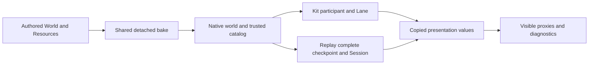

# Authored Box3D samples: Kit and Replay

The two sample projects use the same authored World and shape content. They keep
separate framework setup, ownership and network paths. The earlier `kit_box3d`
and `replay_box3d` examples remain the larger stress/reference scenes; these
authored samples focus on readable project setup and migration. Both ordinary
SDK builds/imports and bounded real Host/Client checks pass on the declared
macOS reference; see [the report](../../../tests/box3d_samples/report.json).

| | Kit authored sample | Replay authored sample |
| --- | --- | --- |
| Project | `examples/kit_box3d_authoring` | `examples/replay_box3d_authoring` |
| Tick owner | Existing Kit Lane | Existing Replay Godot Session/Timeline |
| Initial attachment | `kit/physics.authoring_attach` | `replay/physics.authoring_config` and `authoring_checkpoint` |
| Networked complete state | Kit World protocol 2 and existing network wrapper | Existing complete checkpoint codec, accepted facts and Session |
| Rollback-owned game values | Side plus tracked fields | Typed Game/frame values plus managed solver attachment |
| Presentation | Existing public complete-CP presentation reader | Existing public complete-CP presentation reader |
| Manual reset capability | Public Kit World Reset | Explicitly unsupported by the current public sample facade |

The shared scene has explicit stable keys `ground`, `pendulum`, `player` and
`sensor`. Both seats control the same player body, illustrating why all accepted
inputs must replay against one complete world. The pendulum uses the existing
hinge constraint. Visual Nodes consume copied poses; they do not own the solver.

## Project preparation

The shared preparation helper stages the chosen project, shared content and
authoring addon into a new output directory, then uses the ordinary SDK
script/module build. Native selection is explicit and uses the verified shared
library/build metadata. Open the staged project after preparing it. Source
examples do not depend on generated binaries committed into the repository.

For an explicit verified Native library and a fresh output directory:

```sh
nix develop --command env BOX3D_REPLACE_RUNTIME=1 python3 -B \
  examples/box3d_authoring_shared/prepare.py \
  --framework kit --out /tmp/box3d-kit-authored \
  --native-library /absolute/path/to/libogb3.dylib --build \
  --odin /absolute/path/to/odin --godot /absolute/path/to/godot
```

Use `--framework replay` and a different output directory for the sibling.
The helper records `report.json` beside `project/`. Import/open that prepared
project with the same Godot executable before running it. `--native-sha256` can
bind an expected source-library hash explicitly. Linux uses the corresponding
shared `.so`; platform evidence remains separate.

The sample validation report records the exact commands and output artifacts
actually exercised. Export builds and platform Gate C remain a subsequent
milestone.

## Driver interface and input

The main `Sample` Node uses the project's ordinary
`res://modules/authoring_demo/demo.odin` driver. The shared visual/input script
calls the same small interface in each sibling:

- `status()` returns framework, role, phase, head, confirmed tick and named error.
- `presentation()` returns versioned copied body poses keyed by authored strings.
- `control(x, z, pulse)` supplies quantized input for the next framework sample.
- `request_reset()` reports whether the public reset operation is supported.
- `close()` performs checked ordered teardown.

Presentation JSON contains only `version` and copied body rows with `key`,
`position` and quaternion `rotation`. Nodes and native handles are not canonical
game state. Input is sampled at the existing simulation boundary; rendering and
device polling never advance the native world themselves.

Host and Client roles use `BOX3D_SAMPLE_ROLE`, a shared `BOX3D_SAMPLE_PORT`,
`BOX3D_SAMPLE_TICKS` and `BOX3D_SAMPLE_SCRIPTED`. The bounded automated mode uses
real separate processes and an actual confirmed target. Interactive mode uses
the visible scene controls. Each driver reports unsupported capabilities
explicitly; Replay does not mutate private client phase to implement a reset UI.

## Setup and lifetime order



Each project creates actual SDK Meter/code/data owners before retaining callback
users, codecs, Session or Lane state. Extraction and construction copy all
surviving authoring values. The framework owns its history and complete solver
transactions. Presentation reads public owned checkpoints and copies values.

During shutdown, stop ordinary frame work, close Session/network bindings and
destroy retained complete checkpoints before releasing provider/user/allocator
owners. Check each return value; a declined drop leaves a surviving owner. The
sample result is emitted only after actual teardown. Native/wrapper/Meter
counts must be zero. Owner cleanup uses an observed ledger snapshot before
sample setup and the raw value after teardown; the sample delta must be zero.
Persistent Core/module owners are reported through that measured baseline, not
assumed to be zero or replaced by a fixed constant.

## Reproducing the functional proof

`tests/box3d_samples/run.py` takes one frozen prepared project, its build record,
the exact Godot executable, a unique port and a fresh output directory. It starts
actual Host and Client processes, retains/drains both raw logs, checks natural
exits and the single Native-image binding, and requires each actor to reach the
declared confirmed target.

Each actor exports its final complete view through the existing public API into
`final-frame.json` and the five actual part files. The controller validates
content identity, epoch/tick, paths/hashes and direct byte equality of Solver,
Game, Side, Observations and Occurrences. Replay's Side part may legitimately be
empty. A missing part or unavailable result fails; an equal motion hash is not a
substitute. These are bounded functional sample checks, not a soak or performance
claim.

See the [migration guide](migration.md) for supported operations, limits and
diagnostic meanings, and the [shared API](../../../box3d/authoring/API.md) for
exact input fields, identity and checked ownership contracts.


For the bounded check after preparation, use the corresponding build report:

```sh
python3 -B tests/box3d_samples/run.py --framework kit \
  --project /tmp/box3d-kit-authored/project \
  --build-record /tmp/box3d-kit-authored/report.json \
  --godot /absolute/path/to/godot --out /tmp/box3d-kit-pair \
  --port 28559 --ticks 120 --timeout 90
```

Use a fresh output directory and a free port, and select `replay` with its own
prepared project/report for the sibling. The controller performs the ordinary
editor import first. It preserves actual module-copy PID names and validates
those runtime copies against unchanged base binary hashes; stale verified copies
may be swept by the existing SDK loader. It does not normalize PIDs or ignore
changes to authored files or prepared binaries.

The final observed Kit authority recorded 120 nonzero controls and two pulses
per seat through tick 120. Replay's authority recorded nonzero remote Sample
controls in its actual accepted-input summary. These bounded samples do not
claim long-run input-fidelity rates or a performance ceiling. The controller
source is copied/hashed into each final run output, together with logs, build
binding, actor PIDs, final five-part files and measured cleanup baselines.
