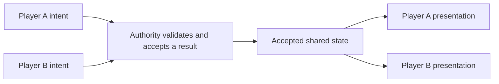

# Authority, ownership, and trust

A shared game needs a rule for deciding whose result becomes accepted state.
This page explains that rule before you choose field tags, a runner, or a
hosting arrangement. It applies to both Kit and Replay.

Imagine two players reaching the last item in a chest. Both screens can show a
plausible pickup. The game still needs one accepted transfer, one remaining
inventory total, and an outcome both players can eventually display.

## Give each result an authority

The **authority** is the process allowed to accept a shared gameplay result.
For a server-authoritative game, clients submit intent and the authority checks
the request against its state. A client may predict an outcome locally while
waiting. Prediction does not give that client permission to settle the result.

Authority concerns a particular value or operation. A co-op game might let a
player provide their avatar's movement while the host decides chest contents
and the score. A competitive game can require the server to derive movement
from inputs too. These are different trust choices, even when both games use
the same host and join buttons.

For the chest, suppose the game's accepted order places A's request first:

| Request | Authority checks | Accepted result |
| --- | --- | --- |
| A takes the item | A may interact, is in reach, and the chest still contains it | Empty the chest and credit A |
| B takes the item | B may interact and is in reach, but the chest is now empty | Leave both inventories unchanged |
| A's request is retransmitted | Its request sequence was already processed | Ignore the repeat without granting another item |

The ordering policy belongs to the game and its selected runtime. A client
timestamp alone cannot establish that its request happened first on the
authority. If the design needs historical hit judgment or scheduled actions,
use the framework's explicit timing policy and validate the request within it.

## Ownership has several meanings

A Godot node, a network entity, and a runtime allocation can each have an owner.
They answer different questions:

| Term | What it determines |
| --- | --- |
| A script's `self.owner` | The Godot object attached to that script instance |
| An entity's network owner | Which player may write owner-controlled fields or issue owner-only operations |
| Gameplay authority | Which process may accept the shared result |
| A runtime resource owner | Who keeps an allocation or callback's code alive and eventually releases it |

Owning a player entity does not permit a client to assign another player's
health. Owning a Godot node does not authorize network mutations. When reading
an API's ownership rule, identify which meaning it uses.

The session's admitted connection-to-player mapping determines which player a
request may represent. A player ID inside the request is data to validate.
Accepting that ID as proof would let a modified client claim another player's
permissions. The application must establish any stronger account authentication
required by its deployment.

## How Kit expresses the choice

Kit's field declarations make the writer explicit. `replicate` fields are
host-written shared state. `owner` fields accept streams from the entity's
network owner. `predict` fields use the simulation lane: the authority computes
accepted state while clients simulate selected state ahead.

Owner-streamed movement suits a group that trusts each player to report their
motion. The host checks the sender's ownership before relaying it; that check
does not establish that the reported position follows the movement rules.
Server-simulated movement is the appropriate starting point when players can
contest those rules.

A Kit command validates and mutates an entity target. The default command
access policy is owner-only; a shared chest needs an explicit policy permitting
the intended players, followed by the game's reach, stock, and eligibility
checks. Accepted cross-entity consequences belong in the authority's paired
`_then` hook. This keeps an inventory credit from running again during target
prediction or reconciliation. See [predicted commands](../../onboarding/04-verbs-not-rpcs.md)
and [network profiles](../../kit/profiles.md).

## How Replay expresses the choice

Replay puts mutable rules in a restorable World. In authoritative networking,
the host or server validates input and settles outcomes. A step can change the
chest, both players' inventories, and their action metadata together. Those
dependencies must belong to the simulation state being restored.

Replay's deterministic P2P runner uses a different arrangement. Participants
exchange inputs and reproduce the match; no peer supplies authoritative state
corrections to another. Choosing the peer that listens for connections does not
turn it into a trusted gameplay referee. Read [determinism](determinism.md)
before choosing that model.

## Hosting does not establish trust by itself

A listen host runs the authority and a local player in one process. The hosting
player controls that process. A dedicated server separates the player from the
authority when it runs on infrastructure that players cannot control. The game
still needs input constraints, authorization, and gameplay validation there.

Keep host input on the same validation path as remote input. A host-only shortcut
can hide a missing permission check during development and make a remote
player's behavior differ from the host's.

Also decide which information clients may receive. A server can decide damage
correctly while still sending hidden opponents or private inventories to every
client. Rendering those values invisibly does not make them private. Authority,
visibility, and transport confidentiality need separate decisions.

## Apply the idea to a small feature

For one shared pickup, describe who may request it, which state proves
eligibility, who accepts the transfer, and what each screen may show before
acceptance. Consider two simultaneous requests, a duplicate, and a request from
a player outside reach. The expected inventory total should remain the same
regardless of which screen first played an animation.

Continue with [state, inputs, and actions](state-and-inputs.md), then use the
[pickup and inventory guide](../recipes/pickups-and-inventories.md) to connect
these decisions to game code.
