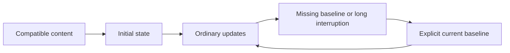

# Budget bandwidth and choose relevant state

A multiplayer game's traffic depends on how often values change, who receives
them, and how much data is needed to interpret each update. This page explains
those costs before you choose replication and relevance settings. It assumes
[state and input](state-and-inputs.md).

Imagine a yard containing moving robots, loose cargo, doors, decorative bolts,
and shelves of immutable item definitions. Sending every transform to every
player at the rendering rate treats all five categories as the same problem.
Their update needs are quite different.

## Count recipients and update frequency

For a stream of similarly sized updates, a useful first estimate is:

```text
outgoing payload bytes per second
    = remote recipients × updates per second × average bytes per update
```

Four remote recipients receiving a 1,500-byte payload ten times a second account
for 60,000 payload bytes per second. This illustrative calculation excludes
headers, acknowledgements, retransmissions, and connection traffic. A server
with many recipients can run out of outgoing bandwidth even when each client
receives a modest stream.

Measure the full update after encoding. A position field's size is only part of
its cost; identity, tick, changed-field information, and packet framing also
travel. Measure busy play, join, and recovery separately. A short match with few
changes can hide the cost of sending a complete baseline to several new peers.

## Choose what changes and who writes it

| Yard data | Useful representation |
| --- | --- |
| Robot movement | Tick controls with authoritative simulation, or an explicitly trusted owner stream |
| A door that changes occasionally | Persistent open/closed state changed by an interaction |
| Item definitions and level geometry | Shared immutable content with a compatible identity |
| A local spark or camera shake | Presentation derived from an accepted or predicted event |
| Loose cargo affecting contact | State within the chosen physics and prediction boundary |

A replicated door still needs initial state and later changes. It does not
necessarily need its own every-tick game callback. Likewise, clients can derive
a decorative animation from a known start tick instead of receiving every
intermediate pose. The derivation must use information recipients actually have.

Use the framework's existing state, command, and event paths. Replacing their
protocol with a stream of transform RPCs can discard baseline recovery,
identity, and delivery behavior you still need.

## Understand relevance before hiding objects

Relevance means deciding which updates a recipient needs. Distance is one
possible rule. Team membership, a shared inventory window, a spectator's target,
and a global objective may matter more than distance for particular data.

Kit's session interest management filters periodic state and owner streams.
Entity existence, reliable lifetime messages, and complete world state retain
broader distribution. Interest re-entry sends current state so a recipient does
not depend on every delta it missed. Read
[Kit sessions](../../kit/session.md) and the
[interest implementation](https://github.com/wlitwin/odin_godot/blob/main/kit/session/interest.odin)
before treating an out-of-interest object as absent. Kit's distance filtering
alone is unsuitable as a confidentiality boundary for secret entities.

Replay provides recipient projections and authored prediction groups. A
projection controls which state a peer receives. A prediction group also needs
the dependencies required to advance that state. If a visible robot can collide
with hidden cargo, the local simulation needs an authored representation of that
interaction. Omitting the cargo's data and predicting as though it never existed
changes the rules. See
[recipient views](https://github.com/wlitwin/odin_godot/blob/main/replay/net/replication.md)
and [prediction groups](https://github.com/wlitwin/odin_godot/blob/main/replay/net/groups.md).

## Preserve a usable baseline

A delta describes a change relative to state the recipient is expected to know.
If that baseline is missing, applying a smaller packet does not recover the
missing information. The protocol needs its full-state or resynchronization
path. The same consideration appears when a peer joins, returns to relevance,
or reconnects after losing history.



Large transfers can be split across packets, but fragmentation still consumes
queue space, bandwidth, and time. Increasing a maximum envelope size permits a
larger transfer; it does not increase the connection's throughput. Bound game
chat, content transfer, and persistence queues alongside framework traffic.

## Balance frequency with display quality

Reducing remote state frequency can reduce traffic while interpolation keeps
motion continuous. Lower frequency leaves larger gaps between samples and may
require more buffering; it can also make extrapolation less reliable. Local
input response, simulation rate,
snapshot rate, and render rate are separate decisions; a faster rendering loop
does not require a packet every frame.

Observe a player leaving and returning to a relevant area while a door opens
and cargo moves. They should return to current state without receiving a burst
of obsolete effects. Record bytes, deferred updates, and time to a usable view.
Then use [performance and scale](performance-and-scale.md) to include CPU and
history costs in the same design.
