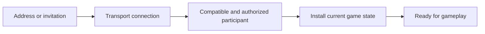

# Connect compatible players to a usable game

Connecting two processes is only the beginning of joining a multiplayer game.
This page explains the stages between an address or invitation and a player who
can safely interact. Use it when a local prototype moves to another machine or
to a browser.

## Separate reachability from admission

A transport carries packets between endpoints. An application still needs to
decide whether the remote participant belongs in this match, whether its build
can interpret the protocol, and which player it represents. Finally, a joining
peer needs enough state to begin presenting and submitting valid gameplay.

These are responsibilities rather than a promise of identical message ordering
in every adapter. A failed stage calls for a different diagnosis. An unreachable
endpoint is not repaired by changing a field schema. A content mismatch is not
repaired by opening another port. A connected player awaiting a baseline should
not be offered interactions whose targets they cannot yet identify.

## Choose a transport for the participants

Native direct sessions commonly use ENet. Browser play uses WebRTC and needs
signaling plus usable connectivity through the selected ICE/STUN/TURN setup.
ICE works through candidate connection routes. STUN helps discover an endpoint's
externally visible address.
Signaling lets peers exchange connection information; a TURN relay carries data
when the selected route requires relay service. A room code is a way to locate
or join a session through an application service, not a guarantee that every
pair of networks has a direct route.

A native ENet client cannot directly talk to a browser RTC endpoint. Mixed
native/browser play needs a compatible transport path on both sides, including
the native RTC extension and matching configuration when using that route.
Steam also needs its corresponding extension and application/account setup.

Start from [Kit transport adapters](../../kit/netgd.md) or
[Replay networking](../../replay/networking.md), then follow the deployment
instructions for the chosen adapter. For threaded web exports, follow
[Exporting](../../exporting.md) for the serving and cross-origin isolation
requirements. A game that works from a local development server can still need
different hosting configuration when embedded on another site.

## Keep player identity separate from a connection

A connection identifies a current transport relationship. A player seat or
reconnect reservation represents application identity across an interruption.
A runtime entity ID identifies an object in the game's current lifetime. None
of these should be replaced by a client-provided player number in a payload.

The authority maps an admitted sender to the player allowed to submit that
input or action. The game then checks the action against current rules. A
valid reconnect credential also needs the appropriate reservation and lifecycle
policy; it does not permit a new connection to inherit arbitrary stale commands
from an old one.

Use [joining and reconnecting](../recipes/joining-and-reconnecting.md) to trace
that lifecycle through a concrete game. A new participant and a returning
participant often need different spawn, inventory, and UI behavior.

## Compatibility includes the meaning of values

Peers can agree that a field is an integer while disagreeing about what item
that integer names. Compatibility therefore extends beyond packet structure.
Agree on schema and protocol, immutable content, gameplay settings, and the
selected simulation policy. Complete physics also binds its backend build,
target, and catalog.

Kit's generated wire schema participates in its join fingerprint. Replay has
explicit schema/content and runtime contracts. Both need the game to identify
changes to rules and content correctly. See [Kit profiles](../../kit/profiles.md)
and [Replay support](../../replay/support.md) for the relevant contracts.

A rejection after updating one peer can be the correct response to incompatible
data. Deploy compatible artifacts together, or build an explicit conversion
where the framework supports that transition. Turning off compatibility checks
does not define how to decode an old enum or restore a different solver image.

## Match trust to the deployment

Plain ENet traffic is unencrypted. WebRTC and Steam have different transport
security properties, while the application's admission and game-rule checks
remain necessary. A checksum can detect changed bytes without proving which
participant was allowed to send them. Likewise, a connected listen host remains
a player-controlled authority process.

Keep connection errors visible to players: connecting, waiting for game state,
rejoining, incompatible build, and rejected admission should lead to appropriate
choices. Keep diagnostics useful to developers by preserving the failing stage
and reason. Continue with [recovery and trust](recovery-and-trust.md) before
offering authority takeover or save/resume as another connection option.
