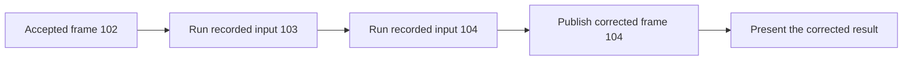

# Prediction, correction, and history

Prediction lets a local simulation respond before accepted information arrives.
Correction reconciles that simulation with the runtime's accepted state or
inputs. This page explains the mechanism and the state it requires, before you
implement [predicted movement](../recipes/movement.md) or shared interactions.

A player pressing right expects movement immediately. Waiting for a round trip
would make the control feel delayed. Running the movement rule locally provides
an early answer, but the client may be missing a collision, another player's
input, or an authority decision. That answer remains speculative.

## Rebuild from a known point

Consider a deliberately small movement rule: a right input moves one unit per
tick. The client starts at position zero at tick 100 and predicts four ticks:

| Tick | Recorded input | Predicted position |
| --- | --- | ---: |
| 100 | Starting frame | 0 |
| 101 | Right | 1 |
| 102 | Right | 2 |
| 103 | Right | 3 |
| 104 | Right | 4 |

The authority then supplies accepted state for tick 102 at position one. Perhaps
a collision blocked one of the moves. The client compares that result with its
stored prediction for **102**, rather than comparing it with its newest position
at 104.

To correct, it installs the authority's frame at 102 and executes the retained
inputs for 103 and 104 again. With this simplified rule, the new current position
is three. A real movement frame also needs velocity, grounded state, timers, and
any other mutable dependencies used by those ticks.

This operation preserves later local intent. Replacing the newest state with an
old authority position and stopping there would discard the input the player
has already supplied since that position was computed.

## State correction and input revision start differently

An authoritative **frame at T** already contains the result of tick T. Install
it, then replay T+1 through the current head.

A corrected **input for T** changes the transition that produced frame T.
Restore the predecessor frame T-1, then replay T through the current head. The
local [inventory correction tutorial](../../replay/quickstart.md) demonstrates
this second operation by revising which player took a chest.

Both operations need a valid starting point and the intervening recorded inputs.
They cannot reconstruct discarded history from a current node transform.

## Capture the dependencies of the rule

Suppose movement also reads a dash cooldown and a moving door's position. If
only the player's position returns to tick 102, the replay may consult today's
cooldown or door and produce another incorrect result. These are missing
historical dependencies, even if they are represented by ordinary numbers.

Kit's ordinary simulation lane retains selected predicted fields on tracked
entities. Replay restores the complete state of its selected simulation group.
The choice changes how you organize cross-entity rules:

| Design | What to arrange |
| --- | --- |
| Kit predicted movement | Retain every field its replayed tick needs; keep accepted cross-entity consequences in authority hooks |
| Kit contested or predict-world state | Choose which entities are simulated locally and make their shared rules replay-safe |
| Replay World | Include entity lifetime, inventories, timers, allocation metadata, and RNG needed by the group |
| Complete Box3D integration | Retain solver state alongside gameplay state through the framework adapter |

Kit also has a complete-world Box3D integration; that contract adds to the
ordinary field-based simulation model. Neither framework can restore a physics
solver from poses alone. See [Box3D multiplayer](../../box3d/multiplayer.md).

Godot node references, input devices, wall clocks, audio, and external writes
remain outside replayed rules. Recorded input replaces fresh device sampling
during correction. An effect emitted by a rebuilt tick must refer to the same
logical occurrence instead of playing a fresh sound on every execution.

## Keep simulation correction separate from smoothing

After the corrected suffix succeeds, subsequent gameplay needs the corrected
state. Presentation may blend a visible object from its old displayed pose
toward that result. Writing the blended pose back into simulation would make
collision and future movement depend on rendering and on how much smoothing
time has elapsed.

The same distinction applies to an early pickup animation. A predicted result
may later disappear. Its presentation needs cancellation or another deliberate
response. A database purchase, platform achievement, or external reward needs
an accepted, idempotent delivery policy outside speculative ticks. See
[presentation and effects](presentation-and-effects.md).

## History bounds the repair you can perform

Stored frames and inputs occupy memory. A set of five consecutive frames holds
four transitions between them. Revising the input that generated its oldest
frame needs an earlier predecessor, which is no longer available.

Prediction limits bound how far a client may run ahead without enough accepted
information. History bounds what it can reconstruct. Confirmation protects state
already settled by the selected protocol. Increasing history does not grant
permission to change a confirmed decision.

When the required history is missing, use the runtime's explicit resync or
recovery path. Replay stages a replacement suffix before publishing it, so a
failed rebuild leaves the previously published history intact. It reports the
failure; the application must respond instead of continuing from a partially
rebuilt world.

Longer corrections also take more work. Rebuilding eight ticks executes the
relevant simulation eight times, with additional capture, validation, and codec
costs where the integration requires them. Runner and physics profiles have
different limits. Choose them using [performance and scale](performance-and-scale.md)
and their references, rather than assuming one universal rollback window.

## Diagnose correction before hiding it

A small occasional correction can result from an unknown remote input. Frequent
correction at the same boundary suggests a missing state dependency, inconsistent
content, or different rules. Repeated sounds suggest effects inside replayed
code. A visible backward jump after a kick can instead come from handing an
object between predicted and watched display times.

Compare a corrected run with a fresh run supplied with the accepted inputs from
the beginning. State and recorded occurrences should agree for the same model.
Then inspect presentation separately. The [testing guide](testing-and-debugging.md)
explains how to narrow the first disagreement before tuning visual smoothing.
