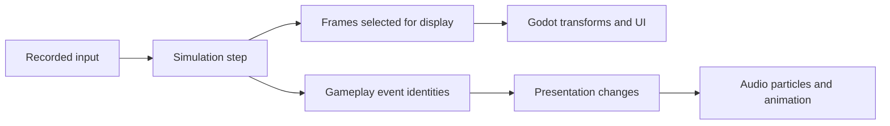

# Present state and effects across correction

A responsive multiplayer game can show a result before the authority accepts
it. This page explains how to draw that result, revise it, and choose which
effects should wait. Read [prediction](prediction.md) first.

Consider a player taking a battery from a shelf. Their machine predicts the
pickup, another player wins it on the authority, and a correction returns the
battery to the first player's view. Restoring the inventory is one part of the
change. The hand animation, pickup sound, HUD, and shelf model also need a policy.

## Give each displayed value a time

The local character may display a predicted position so movement responds to
input. A remote character may display interpolated authority observations from
an earlier time so irregular packet arrivals produce continuous motion. The
scoreboard may display accepted results. These values share a screen while
representing different simulation times.

That difference affects interactions. An explosion should appear where its
displayed cause occurred. A remote muzzle flash should follow the watched
shooter, rather than appear immediately at an unrelated newer pose. A camera
can follow a smoothed local position while hit detection continues to use the
current simulation position.

Godot nodes are the display of these values. Feeding a smoothed node transform
back into the next simulated tick makes the rules depend on rendering and frame
rate. Use the simulation's state for the next step and keep the display offset
in presentation.

## Separate persistent state from a momentary result

The inventory count answers what the player owns now. A pickup event answers
that a particular acquisition happened. Drawing the inventory from current
state handles late join and correction naturally. Playing a pickup sound for
every nonzero inventory value would replay old acquisitions whenever a baseline
arrives.

Use state for durable conditions: a door is open, a weapon is reloading, a round
has ended. Use an identified event when the game needs a distinct one-shot
reaction. The event's identity should survive re-execution of the same gameplay
decision. A fresh random effect ID on each replay makes one shot look like
several unrelated shots.

## Follow one predicted pickup

In Replay, an occurrence is a gameplay result with a stable identity. Its
presentation journal can report these changes:

| What happened to the pickup | Change | View response |
| --- | --- | --- |
| It appears in predicted history | Begin | Start a hand animation and a tentative HUD change |
| The same pickup has revised payload | Update | Move or revise the existing effect |
| The result becomes settled | Confirm | Finish feedback that needs acceptance |
| Correction removes the pickup | Cancel | Stop its animation and remove tentative feedback |

An unchanged occurrence keeps its existing effect. Read
[Replay presentation](../../replay/presentation.md) for the change loop and
identity requirements. A sound already heard cannot be taken back, so a quiet
local response may play immediately while a shared victory announcement waits.

Kit uses its own presentation surfaces. Reliable field edges, generated events,
and simulation tick payloads have different schedules. Keep the authoritative
mutation in the command or simulation path and put audiovisual work in the
corresponding presentation half. The
[Kit timeline rules](../../kit/timelines.md) explain how to align an effect with
its cause. Replay occurrence changes are not a common API imposed on Kit.

## Smooth the error after adopting the result

Suppose correction moves the local player's simulation position from 4.0 m to
3.8 m. The game can retain a temporary 0.2 m display offset, then reduce that
offset over rendered frames. The next gameplay tick starts at 3.8 m immediately.
Smoothing the authoritative simulation itself would change subsequent movement
and contacts, creating another disagreement.

Teleports, respawns, and world changes usually need a visible cut. Interpolating
through a wall or across a whole level can be more confusing than the jump.
Keep the choice tied to the reason for the discontinuity, not just a universal
distance threshold.

## Keep external services outside speculative feedback

Confirmation settles a gameplay result under the selected runtime's protocol.
It does not by itself make an achievement service, purchase, or database write
exactly once. The application needs durable request identity and a policy for
retry, acknowledgement, and recovery when it talks to those services. Replay's
authority archive does not provide an external-effect outbox.

For a useful local experiment, delay a pickup result and let a second player
contest it. Watch the item, both inventories, the animation, and the sound
separately. Then join with a third player: they should see the current inventory
without hearing the complete history of pickups. The
[inventory walkthrough](../recipes/pickups-and-inventories.md) applies these
decisions to the mutation itself.
