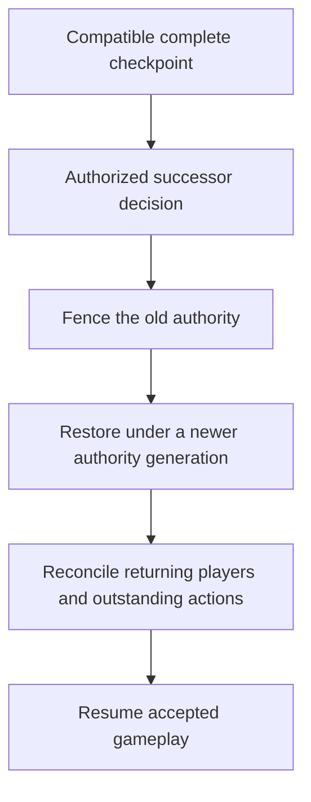

# Recover a session under an explicit authority policy

Recovery decides which saved decisions a game continues from and who may make
new ones. This page explains the difference between reconnecting, correcting a
prediction, restoring a save, and replacing a failed host. Read
[authority](authority.md) and [connections](connections-and-compatibility.md)
first.

Imagine that a host stops responding just after accepting a rare pickup. One
client saw the acceptance; a possible successor holds a checkpoint from two
ticks earlier. Reopening a connection does not decide whether the pickup exists
or which process can now accept more actions.

## Choose the transition the game needs

| Transition | What must be established |
| --- | --- |
| Ordinary prediction correction | Accepted state and sufficient retained history for the predicted suffix |
| Reconnect to the same authority | A valid returning identity, current connection, and usable baseline |
| Resume a saved game | A compatible complete archive and an explicit policy for outstanding work |
| Planned host handoff | A usable final checkpoint and an authorized successor |
| Crash takeover | A usable earlier checkpoint, a loss policy, and protection against two authorities |

A client-only filtered snapshot can be sufficient to draw the game while
omitting private authority state. It is therefore a different object from a
complete successor backup. Deciding which one to send is also a decision about
who receives hidden information.

## Define the recoverable frontier

A checkpoint describes a particular tick. Work after it is recoverable only if
the application or selected recovery protocol retained the necessary additional
decisions. The word "saved" should identify which checkpoint is usable and by
whom, rather than merely that a send operation was attempted.

In the pickup example, restoring the earlier checkpoint can remove an outcome
a client already observed. The recovery handshake must reconcile that client's
outstanding action identity and known outcome with the recovered authority.
Repeating the pickup as a fresh, unrelated action risks changing the inventory
twice when the first result was already retained elsewhere.

A planned handoff can first settle work and arrange a usable final transfer.
A crash can interrupt that process. Choose the acceptable loss window and
player-facing response when designing the game, especially for persistent items
or irreversible rewards.

## Prevent two processes from accepting results

A newer epoch identifies a new authority generation and helps reject stale
traffic. Any process can increment a number in its own memory. That number
alone cannot prove the process was granted authority or stop an isolated old
host from continuing to accept actions.

An authority coordinator or another trusted policy must decide succession and
fence the old authority. The deployment needs a response when that decision
cannot be obtained. Continuing offline, pausing, ending the match, and resuming
from an approved save have different gameplay consequences.

## Use the framework owner that implements the policy

Kit's session lifecycle includes backups and successor behavior for its session
model. The game still needs to keep the relevant state in that model and handle
player leave, reconnect, and game-specific consequences. Use
[Kit sessions](../../kit/session.md) and [game lifecycle](../../kit/boot.md).
The presence of a session backup is not a reason to assume every optional
physics or simulation configuration has identical takeover behavior.

Replay separates direct Session ownership from Party enrollment and coordinated
Room recovery. A direct host/client session is a useful starting point when
host loss ends the match. Room owns its Session when the game adopts coordinated
authority recovery. Read [Replay recovery](../../replay/recovery.md) and the
selected deployment's support limits before promising seamless host replacement.

Complete Box3D state also depends on a compatible native build and immutable
geometry catalog. Recovery must restore its full admitted solver state with the
game state. Poses alone cannot recreate all contact and constraint history.

## Keep persistence and external effects deliberate

Serialization, a successful file write, receipt of a transfer, and durable
storage are different events. A process-crash recovery claim does not settle
power-loss or concurrent-writer behavior. Respect the selected file or browser
storage adapter's documented limits and preserve a rejected save for diagnosis.

External services need their own durable identities and retry policies. Replay's
checkpoint archive has no committed external-effect outbox. A recovered game
cannot infer that an achievement service did or did not process a request solely
from an in-memory confirmation.

For your game's recovery behavior, describe what happens to the pickup, each
player, and the screen during the outage. Test a planned departure and an abrupt
termination separately. The [reconnect walkthrough](../recipes/joining-and-reconnecting.md)
and [testing guide](testing-and-debugging.md) turn those decisions into visible
game behavior.
