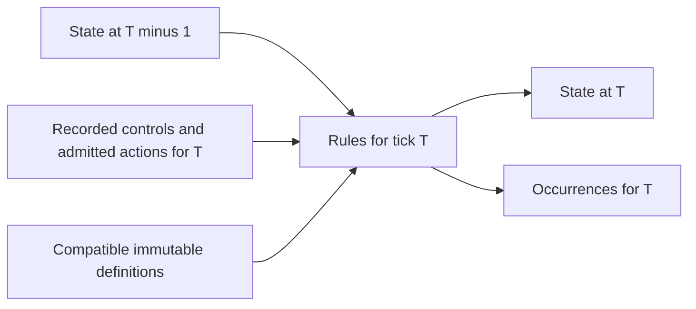

# State, inputs, actions, and events

Separate a shared feature's current result, player intent, and visible effects
before choosing how to network it. This page maps those roles to Kit and Replay.
Read [authority](authority.md) first when deciding who accepts shared results.

Consider firing a weapon. The player holds a trigger, ammunition decreases, a
projectile appears, and a sound plays. Sending one message called “fire” leaves
several decisions unresolved: which tick uses it, whether it can repeat, who
checks ammunition, and what a late joiner needs to know.

## Start with the result that persists

**State** describes the game at a particular point: ammunition, weapon cooldown,
projectile membership, health, or whether a door is open. Another peer can learn
that state without witnessing the operation that produced it.

This matters for joining and reconnecting. A new player needs the door's current
open state. Replaying every historical “open door” call is unnecessary, and
playing its opening sound on arrival may be misleading.

An **input** describes what a player wants the simulation to do. Movement axes,
aim, and a held trigger are typical continuous controls. A **discrete action**
describes an individual request, such as buying an item or selecting a loadout.
Its identity lets the request path recognize a retransmitted operation and avoid
applying the mutation twice. Whether a caller can later retrieve the result
depends on that path's receipt and retention contract.

An **event** records something that happened. Replay calls a recorded simulation
event an **occurrence**; it has an identity used to match it across replay. Kit
also provides declared presentation events. The visual or audible effect that
consumes an event lives outside the replayed simulation.

| Part of a weapon | Role | Who needs it |
| --- | --- | --- |
| Aim and held trigger for tick T | Continuous input | The simulations that must compute tick T |
| An individual reload request | Discrete action | The authority and the request's prediction/result handling |
| Ammunition and cooldown | Gameplay state | The authority and any prediction that reads them |
| A live projectile and its lifetime | Gameplay state | The simulation responsible for its future movement and collisions |
| A recorded shot occurrence | Gameplay result with identity | Presentation and diagnostics |
| A sound player or muzzle-flash node | Presentation resource | The local Godot view |

An RPC is a delivery mechanism. Calling a function remotely does not by itself
define any of these roles or make its arguments valid.

## Choose controls and individual requests deliberately

A held trigger can be a control. The simulation decides whether it fires on a
given tick by consulting the weapon's cooldown and ammunition. That is useful
for an automatic weapon: holding the control produces shots at the game's
permitted rate.

A single press can instead represent one discrete action. Give the request a
stable identity and let its selected schedule determine when it is eligible to
execute. Replay supports scheduled and receipt-time action policies; the choice
depends on whether the feature needs a tick deadline. Both still use validation
and recorded outcomes. Kit commands provide typed target requests and receipts
for accepted or rejected mutations.

Device edges need particular care. A render frame can contain no simulation
tick or several ticks. A brief press must remain pending until the appropriate
input capture consumes it. Reading the keyboard again while replaying an older
tick would substitute the player's current intention for the recorded one.

The same distinction matters during packet loss. Missing controls follow the
runner's hold or neutral policy. Kit's simulation lane can hold the last
accepted input through a gap. A discrete request needs its own sequence and
outcome handling; repeating a transport packet must not grant another item or
consume another magazine.

## Follow the state dependencies of a tick

For a replayable simulation, the relationship is:

Every mutable value read by those rules needs a historical representation. A
stunned flag may change rarely, but if it prevents movement, replay must see the
flag's value at the tick being rebuilt. Its network update frequency does not
decide whether it belongs in history.

Three policies are therefore independent:

| Question | Example |
| --- | --- |
| Who may change it? | The authority accepts health changes |
| Who receives it? | A player sees their own inventory details |
| Must it be restored for simulation? | A cooldown must return with the weapon before a shot is replayed |

In Kit, a reliable replicated value can remain outside the simulation lane when
ticks do not depend on it. When a tick does depend on it, put the relevant value
in replayed simulation data or redesign the tick to avoid reading a present-time
field. Merely adding position to `predict` does not capture all movement rules.

In Replay, World contains the mutable dependencies of the chosen simulation
group. That includes entity membership and allocation metadata, timers, and RNG
state. Godot nodes, sockets, audio players, and device handles remain outside it.
The [World and history guide](../../replay/architecture.md) explains the boundary.

## Separate definitions from changing values

A weapon's base damage or a level's static collision can be immutable session
content. Peers need compatible definitions; they do not need a new copy in every
frame. A temporary damage bonus, moving platform, or changing gravity is mutable
gameplay data and must participate in the appropriate history.

A definition that changes silently halfway through a match changes the rules
used to rebuild old ticks. Version the content and give runtime changes an
explicit simulation-time meaning. [Determinism](determinism.md) explains why
matching a struct layout alone cannot establish matching rules.

## Keep an event separate from its effect

A replayed shot can produce the same occurrence again, change its payload, or
disappear after correction. Presentation needs an identity with which to update
or cancel the existing effect. Generating a fresh random identity every time
the step runs turns one logical shot into several unrelated effects.

Describe a new feature's persistent state, captured intent, accepted outcome,
and presentation effect separately. If a
late joiner needs a value, retain it as state. If every individual occurrence
matters, a field that briefly flips true and false between network samples is
insufficient. Continue with [presentation and effects](presentation-and-effects.md)
and the [weapon and damage guide](../recipes/weapons-and-damage.md).
