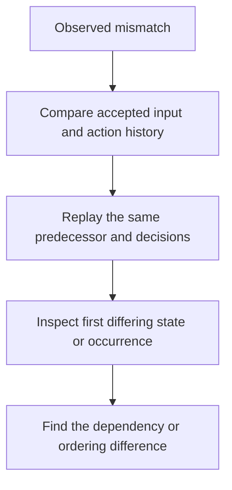

# Test the decisions a network can disturb

A successful two-window run proves that a path can work under that run's
conditions. This page explains how to turn multiplayer behavior into useful
tests and how to locate a disagreement. Start with a small feature such as the
[pickup walkthrough](../recipes/pickups-and-inventories.md).

Suppose two players claim the last battery. A useful rule is that the accepted
result contains one owner and conserves the total number of batteries. A test
that only checks both connections stayed open would miss a duplicated item.

## Test a rule and its observations

Separate the accepted rule from what a player may see while waiting. The losing
player can briefly see a predicted pickup. After correction, their inventory
and the shelf must agree with the accepted result, and the speculative feedback
must be revised. During that wait, the two screens need not show identical
positions at the same wall-clock instant.

Define observable outcomes at appropriate points: an action is settled, a peer
has installed a baseline, a round has ended, or a recovery has completed. A
sleep of a guessed number of milliseconds is a weak substitute for those
conditions on a slower machine.

| Situation | Question to answer |
| --- | --- |
| Delay and jitter | Does local response remain usable, and does accepted state converge? |
| Loss and repeated delivery | Does an identified action change gameplay at most as intended? |
| Reordered or stale traffic | Can an older round, connection, or authority change current state? |
| Join during play | Is current state complete without replaying obsolete effects? |
| Disconnect and reconnect | Is player identity handled separately from its old connection? |
| Host failure | Does the selected recovery policy settle or discard outstanding work explicitly? |

Transport adapters and admission rules already handle parts of delivery and
identity. Test through them as well as testing the pure model; direct function
calls cannot reveal a missing handshake, a full ingress queue, or an unusable
browser signaling route.

## Distinguish expected correction from divergence

Prediction can disagree with authority because it used guessed input. A
correction caused by that disagreement is normal. Divergence is a different
question: did the same state, accepted inputs, configuration, and execution
contract produce a different result?

Two runs with the same physical button presses can accept different tick
assignments because packets arrived before or after an admission deadline.
Compare accepted input histories before treating their different outcomes as a
determinism bug. Preserve the relevant action identities and outcomes too.

For a reproducible simulation discrepancy, find the earliest differing tick.
The first visible failure may occur much later: a different RNG advancement can
change a spawn, which changes a collision, which changes the camera minutes
after the original mistake.

## Inspect the simulation and view separately

First compare accepted game state. If it agrees but the screens differ,
inspect the selected display tick, interpolation, retained effect handles,
camera state, and entity-to-node bindings. Rewriting gameplay state to fix a
visual offset can create a new simulation error.

If game state differs, retain the predecessor frame and the decisions that
generated the next tick. Look for a read of current Godot state, a wall-clock
value, an unrecorded random source, an unstable iteration order, or mutable data
outside the frame. In complete physics, include the solver state and observations
alongside the game state; pose equality covers only part of that boundary.

Replay's [audit diagnostics](https://github.com/wlitwin/odin_godot/blob/main/replay/diagnostics.md)
can retain the first mismatch and compare logical fields. Its
[Godot developer tools](https://github.com/wlitwin/odin_godot/blob/main/replay/godot/debug/README.md)
provide optional overlays, inspection, and recordings. An audit requires retained
generating history; a newly received checkpoint does not imply that its unknown
predecessor inputs are available locally.

Kit provides session/link statistics and a test harness for multiple game
processes. Read [testing Kit games](../../kit/testing.md) for controlled
latency/loss and observable gameplay assertions. Its field, command, and
simulation modes need assertions appropriate to their different contracts.

## Keep enough context to reproduce the problem

Capture the build/content identity, runtime configuration, role, epoch, tick,
accepted decisions, and the smallest state or recording that reproduces the
failure. A network trace, a local gameplay recording, and a complete authority
archive serve different purposes; they are not interchangeable files. Private
authority state and credentials need restricted handling when sharing a report.

Treat missing history, a rejected incompatible build, or a capacity error as the
reported condition. Resetting an epoch, discarding a rejected save, or increasing
all buffers until a run continues removes evidence without explaining the fault.
Use [recovery and trust](recovery-and-trust.md) for the explicit transitions.
