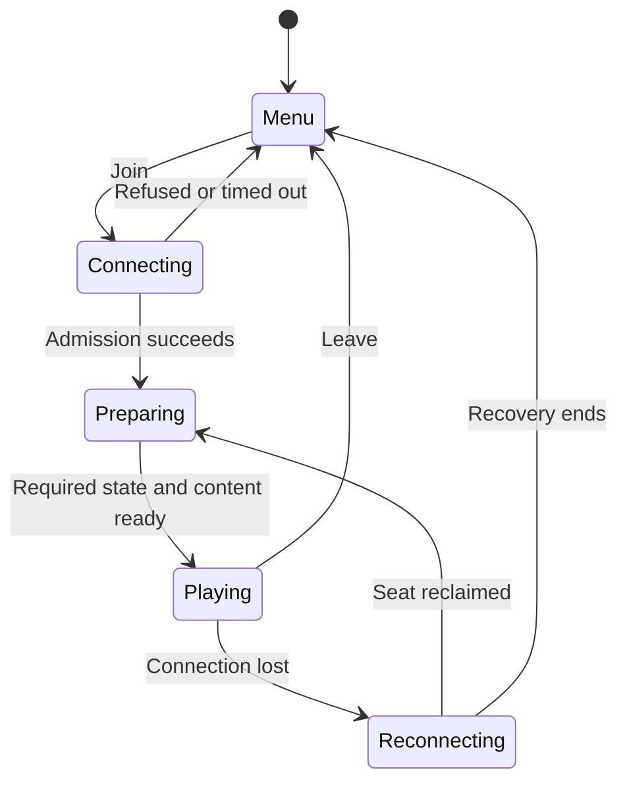

# Handle joining and reconnecting

Design the path from pressing Join to controlling an initialized character,
then make that path recover from a temporary disconnect. Use the
[Kit quickstart](../../kit/quickstart.md) or [Replay Session tutorial](../../replay/godot.md)
for the runnable connection setup.

An open socket does not mean that the player has an admitted seat, compatible
content, or usable world state. Model those stages explicitly in the game UI
and enable gameplay only after the required state is ready.

## 1. Define the player lifecycle

Use a small state diagram to decide what the screen can do at each stage:

These are application states, rather than a required enum shared by both
frameworks. While preparing, show progress or a waiting screen. A player who
can move a default local avatar before the accepted world arrives may see it
teleport, duplicate, or disappear when initialization completes.

In Kit, Boot exposes Menu, Connecting, Lobby, and Playing phases. Its Playing
state records that replicated world state has reached the screen; add any
game-specific asset or level readiness your game requires. In Replay, observe
the selected Session or outer runtime owner's status and build the view from
the admitted state. See [Kit Boot](../../kit/boot.md) and
[Replay networking](../../replay/networking.md) for their distinct lifecycles.

## 2. Install behavior before accepting state

Prepare entity factories, model definitions, callbacks, and the content contract
before opening admission. A state update naming an enemy type is useful only
when this process can construct or display that type.

Kit's generated factories create the initial entities before later reliable
updates refer to them. Keep stable type IDs and initialize presentation from
the appropriate born/state hooks. Replay uses its model/schema/content contract
and the selected runner's welcome or state-transfer path. A large world may
need several transfer packets, so one received packet is not a readiness signal.

Both frameworks need compatible definitions. A build that disagrees about the
meaning of a weapon ID or collision asset must follow the appropriate content
admission policy. See [Connections and compatibility](../concepts/connections-and-compatibility.md).

## 3. Separate a connection from a player

Store gameplay identity separately from the current transport connection.
Connections can disappear and be replaced while a game keeps the player's
seat, inventory, and entity ownership.

Kit distinguishes `Peer_Id` from `Player_Id`. A reconnect token can reclaim the
player identity after the previous connection ends. In Kit, presenting the same
token while the previous connection is still live does not take over that
connection; it can create a different player identity. Give independent local
test players distinct tokens, and use [Kit save](../../kit/save.md) when a token
must persist across application launches.

Replay's admitted roster and reconnect credentials maintain the corresponding
reservation. Keep the player's local credential separate from a public player
name or seat number. A guest claiming “I am seat two” is not proof that they
may recover seat two. The [recovery guide](../../replay/recovery.md) describes
which roster and action-frontier information an authority checkpoint retains.

## 4. Decide what a disconnected player does

Choose a gameplay policy for the gap: stop movement, hold controls briefly,
let a bot take over, pause a cooperative encounter, or remove the character
after a deadline. The framework's missing-input behavior and your game policy
must agree. Continuing the last fire button forever is rarely the intended
consequence of losing a connection.

Distinguish reclaiming an existing player from creating a fresh occupant.
Reclaim can preserve an inventory and score. A fresh occupant may need cleared
controls, a new entity lifetime, and reset progress. Apply those resets through
the authority/model membership path rather than by clearing a local Godot HUD.
Scrapyard's [World and player setup](https://github.com/wlitwin/odin_godot/blob/main/examples/replay_scrapyard/shared/game/game.odin)
shows explicit player generations and entry state.

## 5. Rebuild from current state

After reconnect, refresh the view and pending-action UI from the accepted
state and settled outcomes supplied by the selected protocol. A lost reply
does not prove the operation failed. Reissuing a purchase with a new action
identity can ask the authority to perform a second valid purchase.

Avoid reconstructing the session by replaying old UI clicks. Current bags,
projectile membership, match phase, and action results provide the state the
screen needs. Effects such as join sounds and old muzzle flashes have their
own presentation policy.

A temporary client outage and loss of the authority are different events.
Direct Replay Session setup does not by itself authorize a replacement host;
Party/Room adds the coordinated recovery lifecycle. Kit has its own backup and
succession flow. Decide the host-loss policy explicitly and follow
[Recovery and trust](../concepts/recovery-and-trust.md).

## Check the behavior

Join an empty lobby, a game already in progress, a full game, and a game using
incompatible content. Disconnect during initial state transfer, during a
pending inventory action, and after a player dies. Reconnect with the saved
credential and with a new one; the two cases should follow different policies.

Test a joined client and observer independently. An observer should receive
the intended state without being granted a player avatar or mutation rights.
Try a separate browser tab or process with an accidentally shared credential
to expose identity assumptions before testing over the internet.

Continue with [scenes and rounds](scenes-and-rounds.md) to keep this lifecycle
consistent while the match itself advances.
