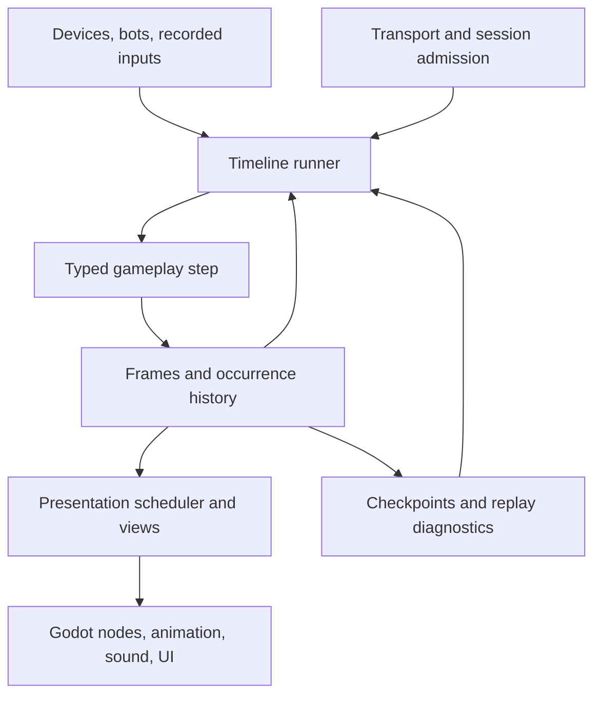

# Replay architecture and initial API

Status: experimental. See the [framework audit](framework-audit.md) for implemented
contracts and remaining work. The original [Kit](../kit/index.md)
remains a separate supported implementation.

## Objective

Gameplay operates on a **World**, the typed value containing all mutable
simulation state. A **frame** stores that value at one tick. A **step** applies
the next input batch and records gameplay results as **occurrences**, each with
an identity that presentation can track across replay:

```text
step(frame at T, input batch for T+1) -> frame at T+1 + occurrences
```

A **runner** owns input delivery, stepping, retained history, correction, and
presentation scheduling. Single-player uses the same simulation contract. The
author still chooses game rules, authority, prediction scope, and which effects
may be shown speculatively.

Input sampling and intent delivery have separate contracts. Scheduled controls
belong to a simulation tick and can arrive too late to use. Discrete actions carry
sequence IDs and settled authority results. A game can classify actions as
scheduled or receipt-time through a versioned [action schedule](../../replay/net/README.md):
for example, preserve a shot's deadline while delivering an interaction without
that deadline. Prediction still reconciles against the authority's recorded
decision. Receipt-time delivery does not override game predicates or FIFO order.

## Decisions for the experiment

1. **Simulation state is independently restorable.** Entity membership, allocation
   counters, timers, and RNG are state. Rendering resources and connections are
   outside the frame. Immutable definitions are content-versioned inputs to a
   session; mutable configuration changes must be tick-stamped.
2. **History follows gameplay dependencies.** Health that gates movement belongs
   in simulation history even when its network updates are infrequent. Being
   historical, being authoritative, and being replicated are separate policies.
3. **Complete state per simulation group.** Cross-entity mutation is ordinary
   code. The default group is the public world; an authored client projection can
   remove nonmembers and retain explicit timestamped boundary values. Replay
   restores that complete group. Multiple independent groups remain later work;
   see the [implemented group contract](../../replay/net/groups.md).
4. **Typed state before code generation.** The API is usable without scriptgen.
   Generated authoring must use a documented public API.
5. **Presentation receives copies or explicitly read-only views.** It never
   temporarily overwrites simulation fields. The initial API uses copies because
   Odin does not provide a general deeply immutable borrowed view.
6. **Independent library and game ports.** No aliasing the new API onto Kit's
   session/lane internals, no replacing old games, and no hidden fallback between
   implementations. Engine bindings and suitable pure utility algorithms may be
   shared through explicit dependencies.

These principles are informed by the complete-state and independent-step
contracts in [GGPO](https://github.com/pond3r/ggpo/blob/master/doc/DeveloperGuide.md)
and [Quantum](https://doc.photonengine.com/quantum/v3/manual/quantum-ecs/systems).
They do not require adopting either product or requiring an ECS authoring model.

## Layer boundaries



The core, canonical codecs, presentation, authoritative and deterministic P2P
runners, owner streams, diagnostics and coordinated recovery are implemented.
Their supported envelopes differ; engine physics remains an explicit cooperative
policy rather than a deterministic rollback solver.

Implemented package boundaries:

| Package | Responsibility | Status |
| --- | --- | --- |
| `replay` | Typed frames, local timeline, bounded history, pools, RNG, events | Value storage, transactional replay/correction, audit captures |
| `replay/schema` | Logical fields, canonical codecs, hashes, field diagnostics | Runtime field programs, tagged unions and transactional codecs; static codec generation is optional future work |
| `replay/telemetry` | Bounded admitted-session round-trip probes and reports outside rollback state | Core, Godot adapter, native/browser tally and native migration gates tested |
| `replay/view` | Interpolation and predicted/confirmed/canceled event presentation | Journals, rebase, one-shot/cue retention, pose/phase sampling |
| `replay/authority`, `replay/provision`, `replay/recovery` | Authority terms, enrollment, checkpoint transfer and migration | Authenticated registration, durable CAS, leases and recovery protocols |
| `replay/net` | Seats, controls/actions, facts/snapshots, correction/reconnect | Scheduling policies, prediction/recipient groups, deltas/compression and recovery ledgers |
| `replay/p2p` | Deterministic input exchange, rollback and participant recovery | Fixed-roster runner, archives, spectator recovery and authenticated provisioning |
| `replay/owned` | Cooperative owner-driven observations and transfer | Explicit ownership/version/producer lineage and action context |
| `replay/transport` | Packet interface and deterministic fault model | Implemented and tested |
| `replay/godot` | Godot transport/view/scene integration | Session, Party/Room, P2P setup, scene/body/audio adapters and tools |
| `replay/play` | Replayable movement, collision, abilities, inventory helpers | Value-based motion/query, timers, gun/effect/director helpers |

Create subpackages only when implemented responsibility warrants them. The table
does not reserve a permanent layout or require empty scaffolding packages.

## Current local API

`Timeline(State, Input, Event)` is a runtime owner. `State`, `Input`, and `Event`
must recursively satisfy `value_supported`. The runner allocates bounded history
and equally sized replay scratch during `init`; normal stepping and correction
use those allocations. User callbacks must also avoid hidden allocations/state
if the game needs that property.

| Operation | Contract |
| --- | --- |
| `init(&timeline, Frame(State){...}, step, cfg, epoch)` | Establish a checkpoint at any tick, including zero; reject unsupported types and invalid config before allocation |
| `advance(&timeline, input)` | Execute tick `head+1` in scratch and commit on success |
| `current(&timeline)` / `read(&timeline, tick)` | Return a frame by value plus an existence flag |
| `revise_input(&timeline, tick, input)` | Replace the complete input batch at that tick and replay through the current head; commit the entire suffix only on success |
| `confirm_through(&timeline, tick)` | Monotonically settle state through that tick; subsequent input revision cannot alter it |
| `correct(&timeline, truth, events)` | Atomically ingest complete authority state/events and replay the speculative suffix |
| `reset_checkpoint(&timeline, frame, epoch)` | Explicit resync/recovery; discard old speculative history within an authorized epoch contract |
| `rewind(&timeline, tick)` | Keep that frame and discard later speculative history; committed playback requires a fresh timeline/epoch |
| `audit(&timeline, from_tick)` | Replay recorded inputs without committing; report first differing tick and state/event category |
| `copy_events(&timeline, tick, dst)` | Copy the complete occurrence batch or report required capacity without a partial copy |
| `destroy(&timeline)` | Release runtime storage; safe on a zero/destroyed timeline, invalid inside a step |

Tick semantics: input for T transforms state at T-1 into state at T. A starting
checkpoint has no recorded generating input. Revising that checkpoint is an
`Initial_Frame` error; revising a tick whose predecessor fell out of history is
`History_Missing`. Neither case silently replays from current state. Near the
u64 tick limit, `advance` reports `Tick_Overflow`.

`Config.history_frames` counts stored frames, including a checkpoint. A history
of N frames can replay at most N-1 transitions without another checkpoint.
Values must be 2..4096. `events_per_tick` is 0..4096; zero intentionally disables
event capacity. `DEFAULT_CONFIG` is 128 frames and 32 events per tick. These are
prototype resource limits, not supported multiplayer scale envelopes.

`Result.steps` counts successfully staged steps, even if a later step failed.
`Result.tick` is the failing tick or final processed tick. Only a successful
revision commits staged results. Audit never commits.

The starting checkpoint is confirmed. **Confirmation** marks state as settled
under the runner's authority or commit protocol. The **confirmation frontier**
is the latest settled tick; the runner advances it explicitly. `revise_input` rejects
committed ticks and `rewind` rejects movement before the frontier. Copying an old
frame into a new timeline remains valid for playback inspection or an authorized
recovery protocol; neither operation is an authority election.

## Simulation rules and transaction boundary

A step may read its state, input, tick, and fixed definitions, and mutate state
through ordinary Odin functions. It must not access wall clocks, device state,
Godot node transforms, ambient random generators, persistent storage, sockets,
or mutable globals. Pool pointers and `Step` pointers must not escape the call.

The candidate tick is a value copy. If `abort` is called, the event journal
overflows, or an event ID duplicates another in the tick, the runner discards
that candidate. A revision stages its **complete suffix** before committing:
failure at tick 9 cannot leave ticks 5..8 changed in a supposedly rejected replay.

This protects managed state. It cannot reverse audio, I/O, mutations through
global pointers, or other side effects in a callback that violates the contract.
The type gate excludes pointer-bearing frame values but does not prove callback
purity. Audit is a diagnostic supplement, not a static effect system.

Ordinary unsuccessful gameplay actions should validate before mutating. `abort`
rejects the complete tick, including other players' actions in that batch. Use it
for inability to simulate the tick safely, not as the default response to a
player trying an unavailable item. The Loot example ignores an invalid
take and continues with the other player's input.

## Entity identity and lifetime

`Pool(T, N)` stores entities and allocation metadata inside the frame. Insertion
chooses the lowest reusable index and returns `Handle(T){index, generation}`.
Removal clears the payload. Reusing a slot increments its generation; a slot
whose generation is exhausted is retired. Restoring the frame restores entity
existence and allocation order as well as payloads.

Handles are typed and local to their pool/world. Two pools of the same type still
require the caller to choose the right pool. They are not yet global network IDs.
A rewound alternate branch can recreate an ID; a presentation object must resolve
against the current view and must not treat a stale handle as a global lifetime
guarantee. Wire IDs, provisional spawn identity, and branch-aware presentation
reconciliation are separate contracts of the network runners and presentation
layer; the pool itself does not supply them.

## Occurrences

`emit(ctx, source, key, payload)` records an `Occurrence(Event)` with identity
`(epoch, tick, source, key)`. The author supplies a semantic source and key; the
loot example combines the action sequence and an effect slot. Reordering two
unrelated emits does not change identity. Duplicate keys fail the tick instead
of ambiguously correlating two occurrences.

Replaying replaces the tick's occurrence batch. It does not invoke effect
callbacks. The [presentation journal](../../replay/view/README.md) compares previous
and replacement batches by ID and payload and produces begin/update/cancel/confirm
notifications. Confirmation follows an explicit authority/commit frontier and
watched effects also wait for their display tick. Effects that require durable
external delivery still need a separate committed outbox and idempotent consumer.

The epoch scopes IDs. Starting a timeline with epoch 2 does not
prove that it is the legitimate authority. Leader selection, stale-packet
fencing, input sequencing, and reconnect credentials belong to the session layer.

## Snapshots, wire state, and determinism

The frame is a typed in-process value. Copying it makes a detached checkpoint,
and another timeline can resume from it. Canonical value/envelope codecs, durable
saves, and the native coordinated recovery profile are implemented. Padded structs
are safe to copy; audit uses logical
reflection equality rather than a raw memory comparison. NaNs compare unequal
and will surface in audit; the network schema enforces finite values and the model
validates gameplay-specific input and state policies.

The canonical schema describes logical fields independently of compiler layout
and applies bounds. Its envelope carries schema/content/version/epoch metadata.
Authority/public codecs and explicit [recipient views](../../replay/net/replication.md)
are implemented, including state/control/event filtering and separate prediction
groups. Alternative replica carriers and broader migration/deployment profiles
remain additional work.
A client's visibility-filtered snapshot is not a complete migration backup.

Strict P2P mode requires cross-target reproducibility: math,
collision algorithms, iteration order, allocation, RNG, and input ordering. The
integer Duel example has native arm64/WASM execution equality and a separate
peer-input runner. That evidence is scoped to its tested corpus, not arbitrary
models or every target; see [P2P](../../replay/p2p/README.md).
Server-authoritative mode can tolerate numerical discrepancies but still needs
replayable state and useful correction limits.

## Physics, sessions, and migration

Simulation collision must use frame-owned dynamic state. Static level assets can
be immutable query inputs; moving doors/platforms must have historical state.
An ordinary Godot physics world is not made replayable by saving node poses.
Replayable movement uses explicit kinematics and collision math.
The [owner-streamed profile](owner-streams.md) provides latest-observation admission,
saved owner/handoff state, and Godot 2D/3D adapters. It records accepted engine outputs;
it does not replay Godot contact solving. A separate Slopball port exercises the
initial profile, including planned/crash physics migration; broader scenarios remain pending.

A complete migration checkpoint combines a full authority frame,
content/protocol versions, session membership/ownership, action deduplication
frontiers, and an authority term. Host selection and transport rendezvous remain
separate services. They must establish a unique accepted term before simulation
resumes. Read [the migration milestone](roadmap.md#m5--session-recovery-and-host-migration)
for failure cases and acceptance gates.

## Diagnostic and performance direction

Start with value copies and explicit step order. Measure snapshot bytes, copy
cost, replay cost, event backlog, and allocation pressure before implementing
page sharing or incremental snapshots. A typed arena or component store can
replace fixed pools without changing the frame contract, but requires restore,
allocation-order, and codec tests first.

Extend audit to emit a path such as `players[1].inventory[3].count`, both values,
the triggering input, and a reusable reproduction file. Allow deliberate replay
every frame during offline play. Keep multiplayer fault schedules recorded so a
failure is reproducible independently of real packet arrival timing.
