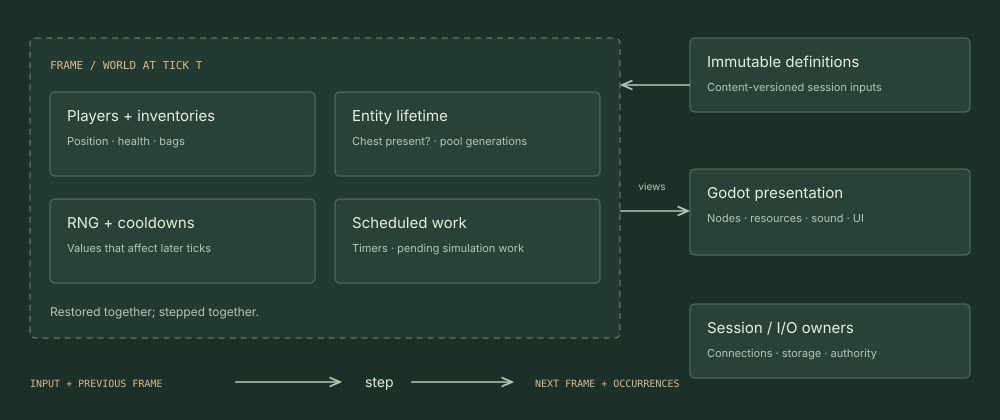

# Replay

Replay is a multiplayer framework for games whose mutable rules can run on an
explicit, restorable World. It retains frames and input history, predicts local
input, and rebuilds affected ticks when accepted state differs. Godot handles
scenes, devices, animation, and audio outside that simulation.

Learn [Odin scripting](../scripting/index.md) first. Kit is an alternative; you
do not need to learn or install its session framework to use Replay. Replay is
experimental. Read [support and compatibility](support.md) when selecting a mode.

The local Timeline is engine-free. The current Godot Session package also links
the Box3D presentation adapter; its [setup guide](godot.md) includes the required
backend build even for a value-only game.

## The model

A **World** contains mutable values needed for the next tick: positions, health,
inventories, cooldowns, entity membership, allocation metadata, and RNG. A
**frame** captures the World at one tick. A **step** consumes input and changes
the World. A **runner** retains history and decides when to step or replay it.

```text
World at tick T + input for T+1 → World at T+1 + occurrences
```

An occurrence records a gameplay result with an identity presentation can track
across replay. Scene effects run after stepping, using occurrence changes and
copied frames. A corrected pickup can therefore restore both inventories and
the chest while presentation revises its sound or animation separately.



## Learn Replay

For signatures and types, use the [Replay core API](../api/generated/replay.md)
and [Godot Session API](../api/generated/replay/godot.md), or
[search all declarations](../api/index.md).

| Page | What it covers |
| --- | --- |
| [Correct an inventory transfer](quickstart.md) | Run a local model, revise input, inspect the result, and connect the model to Godot |
| [Connect a Godot session](godot.md) | Copy the starter into a new project and run solo or as a local host/client |
| [World and history](architecture.md) | Decide what belongs in restorable state and understand correction boundaries |
| [Networking](networking.md) | Select a runner, authority policy, transport, and prediction scope |
| [Presentation](presentation.md) | Display copied frames and handle effect Begin, Update, Confirm, and Cancel changes |
| [Cooperative owner streams](owner-streams.md) | Integrate trusted owner-driven bodies and observations |
| [Recovery](recovery.md) | Choose Session or Party/Room and understand checkpoint and authority ownership |
| [Box3D integration](../box3d/multiplayer.md) | Retain complete solver state alongside gameplay state |
| [Support](support.md) | Check runtime limits, platform scope, and compatibility |

## Choose a runtime owner

| Need | Owner |
| --- | --- |
| Local value simulation | `replay.Timeline` |
| Offline or direct host/server/client/observer in Godot | `replay/godot.Session` |
| Invitations and rejoin | `Party` |
| Coordinated authority recovery | `Room`, which owns its Session |
| Fixed-roster deterministic peer rollback | Admitted P2P setup and `replay/p2p.Runner` |

Pump the outer runtime owner once per frame. Room already drives its Session;
Session already drives its selected runner and transport. Keep runtime owners
at stable addresses until closing them.
