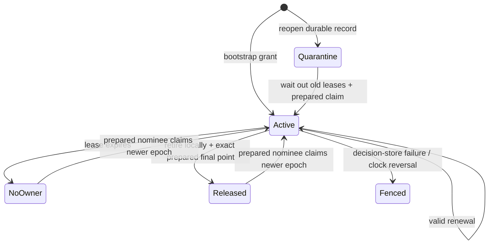

# Replay authority decisions and leases

Use this package to decide which process may accept a room's gameplay results,
and to transfer that authority when its process stops or hands off. A coordinator
grants time-limited leases; the network runner checks their permits at gameplay
boundaries. Prepared checkpoints let an eligible successor restore the exact
state approved by the coordinator.

See [service and storage](service.md) for authenticated RPC and SQLite storage,
the [Room driver](../godot/room.md) for live-session integration, and the
[admission backend](../provision/README.md) for durable invite/join transactions.
The validation sections below retain the scope of the initial M5 integration
gates. Use the [compatibility map](../compatibility.md) for current formats and the
[framework audit](../../docs/replay/framework-audit.md) for the current failure matrix.

## Decision model

The coordinator governs one room/content contract. A trusted admission service
provisions `Member` records: stable member ID, process incarnation, endpoint, and
permission to receive authority data/host. Cooperative rooms may nominate trusted
players; dedicated rooms require the infrastructure flag as well. A peer cannot
register or promote itself through an unauthenticated call.

`coordinator_start` grants the configured bootstrap member epoch 1.
`coordinator_renew` requires the same owner/incarnation and epoch, a still-live
lease, a newer request sequence, and a nondecreasing known authority tick.
Replaying a renewal request does not extend its expiry. An expired owner must use
the recovery protocol; it cannot revive the expired epoch with another renewal.

The current owner nominates a successor and the gameplay connection binding used
for its checkpoint. The successor makes an owned `Prepared` copy of an exact
validated archive, then reports that point with `coordinator_prepare`. Claiming
requires that exact point and identity, continued eligibility, and the configured
limit on rollback from the coordinator's **last known** authority tick. This is not
an upper bound on unobserved work after the last heartbeat.



Planned release is permitted before the old deadline only after the old process
irreversibly retires its local `Lease`. The resulting `Retirement` identifies the
owner, room, epoch, and observed revision. It is authenticated caller data, not a
cryptographic certificate. `coordinator_release` also requires the exact prepared
final checkpoint, at least as recent as the last recorded authority tick. Once
released, the old lease cannot be reactivated by a delayed reply. Abrupt claims
wait for expiry. Each successful claim increments the epoch and records the
recovery point and kind. Competing/old-owner claims and stale incarnations fail.

## Durable store and coordinator restart

Every mutation calls `Commit(user, expected_revision, next_record)` before changing
the active record or exposing a grant. The backend must atomically compare the
revision and durably store the complete next record. A failure poisons that
coordinator instance and suppresses further grants/views. Model tests use an
in-memory CAS ledger; the separate SQLite adapter has transaction/restart gates.

Initialization also commits a new coordinator generation/revision, invalidating
an earlier instance's subsequent CAS writes. When reopening a record that has
issued an epoch, the new coordinator does not reuse its predecessor's absolute
clock deadline. It quarantines for:

`ceil(lease_ms × (1 + drift) / (1 - drift)) + margin_ms`

before permitting a claim. This outlasts the previous possible lease even with
opposite clock-rate errors. The persisted epoch floor is preserved. This requires
one authoritative, linearizable durable store; independent writable copies of a
room's store are not a supported coordination topology. Do not reset the record
or reuse a room ID to bypass unavailable storage or the quarantine.

Coordinator loss therefore stops authority after existing leases expire. A
partition cannot independently elect a host through this profile. The coordinator
reachable side may recover after the old lease expires; isolated participants
freeze and later replace their state from the approved authority. Divergent
inventories are never merged. A quorum-based decentralized profile remains separate
work for deployments that cannot use a decision service.

## Clock and reply contract

`Lease` records the local time and sequence **before** sending a request. Only one
request is outstanding; retransmission uses that original sequence/time. A valid,
authenticated reply contains relative remaining duration, rather than a foreign
machine's absolute deadline. With maximum clock-rate error `d`, the local deadline is:

`request_start + floor(remaining_ms × (1 - d) / (1 + d)) - margin_ms`

The larger of the local and coordinator drift bounds is used. Because the request
starts before the coordinator processes it, this expires conservatively even
without synchronized clock origins and with delayed replies. Expired replies,
old revisions/epochs, clock reversal, and unavailable clocks cannot revive a lease.
The default bound is 1,000 ppm with a 20 ms margin; it is a deployment assumption,
not a measured guarantee for arbitrary clocks or virtual machines.

Read current clock time for every permit check. It must advance during sleep and
process suspension. Native adapters use
[Apple's mach_continuous_time](https://developer.apple.com/documentation/kernel/1646199-mach_continuous_time),
[Linux CLOCK_BOOTTIME](https://man7.org/linux/man-pages/man3/clock_gettime.3.html), and
[Windows QueryPerformanceCounter](https://learn.microsoft.com/en-us/windows/win32/sysinfo/acquiring-high-resolution-time-stamps).
Godot's normal tick clock being monotonic alone is insufficient evidence that it
includes system sleep. Unsupported targets return an unavailable native clock;
browser lease support requires a verified embedding clock. Mac native execution
and Linux/Windows/WASM type-checks pass; actual Linux/Windows suspend behavior has
not been exercised by this repository's gate.

## Runner enforcement

Set `Config.require_permit=true` and provide `Permit` at server/client initialization.
`lease_permit` supplies it from a live `Lease`; an authority lease additionally
requires that the view's owner match this process's identity. An observer/client
lease tracks the currently approved epoch without granting itself authority.

The runner checks before accepting local gameplay, pumping gameplay packets,
predicting/advancing ticks, and issuing gameplay sends. `Timeline.advance` also
checks an optional `Commit_Gate` after simulation but **before** publishing the
candidate. Rejection preserves the entire history ring, including its oldest slot,
and the action frontier. Client prediction also restores its action's pending flag.
Checking before publication preserves the oldest frame even when the ring is
full; rewinding after publication would be too late to recover it.

`net.Error.Fenced` is an expected pause. Godot `Session` exposes `session.fenced`,
stops ticking and clears clock backlog, and allows the application to keep its
coordinator/recovery UI running. Permit checks must read a fresh clock, not a value
cached at frame start. Packets accepted by a transport before expiry may arrive
later; the approved new epoch fences them at the new authority/client context.
External persistent effects still need resource-side epoch/idempotency enforcement;
the future outbox is not implemented here. This profile assumes cooperative
participants and authenticated coordinator calls, not Byzantine host resistance.

`Prepared` owns canonical archive bytes independently of the receiver's recyclable
slots. `prepared_restore` requires a live owner lease whose recovery point exactly
matches them, verifies the bytes, and restores a fresh server with the permit and
new epoch. The caller provides the selected game seat/policy adapter. The
[Room driver](../godot/room.md) maps the authenticated member to its stable game
token and seat.

Requiring permits is part of the handshake contract and survives checkpoints.
The initial integration described here used experimental network protocol **5**,
archive format **3**, control RPC **2**, and decision record **3**. Its loader
rejected earlier Replay archives and provided no automatic converter. Original
Kit saves/projects were unaffected. See the [compatibility map](../compatibility.md)
for current rejection and conversion rules.

## Validation and remaining integration

```sh
nix develop --command bash tests/replay_authority/run.sh
nix develop --command bash tests/replay_authority_godot/run.sh
```

Twenty-four native tests cover partition timing, planned retirement, storage failure,
restart quarantine/CAS fencing, late replies, renewal replay, adverse clock drift,
eligibility/incarnations, known rollback limits, consecutive migrations, old-host
return, durable-record codecs, native time, expiry during server/client simulation,
history retention, and owned-checkpoint restoration under the exact grant. The
prepared restore test transfers a real archive over the memory transport before
destroying the receiver and changing authority. It is not a real-process takeover.

The Godot gate uses the native clock to run and then fence the actual cave model;
it verifies the head stays fixed and renewal after expiry is denied. It uses an
in-process coordinator and test ledger. Separate Room gates now route approved
endpoints/epochs into live Cavecrawl sessions and reconcile surviving clients during
planned/crash takeover. Those initial gates do not complete the full M5 matrix.

[Durable member removal](moderation.md) is an optional authenticated operation
for the current live authority. It atomically disables the member and invalidates
its prepared succession right without changing existing RPC schemas.
