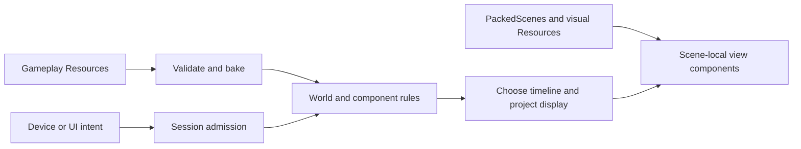

# Editor-first Replay authoring

Author Replay scenes in Godot while keeping gameplay state in replayable Odin
values. This page describes how scene scripts, immutable definitions and typed
display values meet that boundary.

[Replay Scrapyard](../../../examples/replay_scrapyard/editor-first.md) is the canonical
worked example for this workflow. It demonstrates server authority, local prediction,
observed remote presentation, typed scene composition and recovery. Other network
policies still use their appropriate examples; Scrapyard is not a universal game
architecture or a claim of production certification.

## Two compositions, one explicit boundary

Compose gameplay from owned state and pure procedures: movement, health, gun
mechanisms, inventory, cooldowns and AI. A frame stores the complete `World` state at one tick;
it can contain many typed components and modules. Godot nodes, Resources, device
state, animation clocks and I/O remain outside it. `examples/replay_recipes/components.odin`
is a compile-checked small composition; Scrapyard's Player/Gun_State/Cooldown and
separate game/brains/abilities/effects modules show the larger version.

Compose presentation with normal PackedScenes and node-local Odin scripts.
Appearance Resources, child offsets, texture atlases, colors, line geometry and
layout are editor-owned. A view receives a detached value, stores local presentation
state, and uses its normal `_process`/ready/exit lifecycle. An animation callback
may play a cosmetic effect; gameplay damage must come from replayable rules.



## Bind a scripted scene

The [typed adapter helpers](adapter-bindings.md) provide owned archetype bindings,
borrowed permanent-scene bindings, explicit scope tracking and typed iteration.
Scrapyard uses optional `//gd:replay_view` descriptors over those same APIs. The
low-level `Script_View`/`View_Pool2` composition below remains available.

`Script_View(Value, Script)` adapts an ordinary generated Odin Node script to the
existing typed `View_Pool2`. Keep the configuration and pool at stable addresses.
The scene instance enters its parent before binding, so its children and `_ready`
state are available. The framework resolves the exact script type; a missing/wrong
script or failed scene validation rejects attachment and cleans up the pool.

```odin
binding: scenegd.Script_View(Enemy_Display, Enemy_View)
views: scenegd.View_Pool2(Enemy, Enemy_Display, ^Enemy_View)

binding = {
    present = enemy_view_present,
    validate = enemy_view_validate,
    retired = enemy_view_retire,
}
ok := scenegd.view_pool_load(&views, parent, "res://enemy.tscn", capacity,
                        scenegd.script_view_binding(&binding))
error := scenegd.view_pool_present(&views, scope, items)
```

`present` receives a value, not a World pointer. It may delegate to typed child
view scripts. `validate` returns a `definitions.Report` describing missing or
invalid scene components/assets. `retired` is
optional and can stop local processing or discard pending visual notices before
queued node deletion; it must also tolerate a partially initialized script after
failed validation. Godot owns the script instance; the rig borrows its pointer and
must never delete it. Parent, configuration and compiled script module must outlive
the pool. Destroy/rebind across scene or script-module replacement.

`validate` is the only validation callback. Older `valid = boolean_check`
descriptors must migrate to a report-returning validator, preserving their
component and appearance checks. See the [migration example](adapter-bindings.md#script-descriptors).

The ordinary Godot process callback advances animations even when unchanged data
skips `present`. Do not additionally call the framework frame hook for the same
animation clock. Deliberately batched renderers may use the lower-level Rig/frame
API instead. Neither mechanism runs simulation during replay.

## Choose identities and property ownership deliberately

Entity views use full generation handles and explicit epoch/reset scopes. Missing
entities retire; replacement generations get new script lifetimes. The adapter
recognizes game boundaries such as a new floor/run or an observation reset.
The game-specific scope policy is visible code, not an inferred authority rule.

A fixed-seat roster/avatar or permanent HUD may instead keep an authored scene for
its UI lifetime. Scrapyard's four runner scenes represent seats; their display
includes body generation/warp/epoch so local transient cues reset on body rebind.
Their node identity survives a respawn. Enemy scenes represent entity lifetimes
and are replaced. Both are intentional identities with explicit reset behavior.

Give each property one writer. For entity pools, the bridge owns the root transform;
child view scripts animate authored children. For permanent runner scenes, their
view script applies the selected/smoothed root pose. Capture authored child origins
and scales in ready, then apply relative animation. A child offset edited in the
scene should not be overwritten by a magic position in a central render loop.

A view can publish a local visual notice for a presentation service. Scrapyard's
enemy view reports observed health loss to its adapter, which routes particles and
screen feedback. That notice cannot issue damage or change authority state. UI
commands use the normal Controls/Action_Intent admission path.

## Resource authoring and gameplay changes

Use the existing typed Resource scripts for inspector editing. Bake and validate
the complete candidate before opening a runner or replacing a definition set.
Useful errors include the resource path and field. Reject duplicate identities,
invalid ranges and missing references. Copy complete values into World/checkpoints,
or explicitly retain every external definition version needed by history.

Visual-only Resources can remain local scene assets. Scrapyard's enemy appearance
Resources hold atlas frames, textures, tint and presentation speed; gameplay MobDef
Resources hold health, speed, radius and combat data. Editing an appearance does
not secretly alter collision or damage. Root visual scale is not a physics bake.
The library does not automatically convert arbitrary Godot physics scenes into a
deterministic collision model.

Adding a gameplay component requires its owned state, step/action functions,
validation and any authoring-to-value mapping. Adding an arbitrary gameplay script
to a Node does not make its hidden fields replayable. Persistent schema/rule changes
need the project's compatibility/version policy; adding a decorative child does not.

## Recommended boundaries and exceptions

Permanent actors, equipment and HUD components benefit from authored scenes and
local scripts. Generated arenas, dense projectile batches, trails and procedural
geometry can remain specialized renderers. Keep their lifetime and sampling policy
explicit and measure them before changing allocation strategy. A component need
not be a separate script for every Sprite; encapsulate a coherent visual behavior.

Pure UI display, camera following and animation can use display state. Permissions,
hit judgment, ownership transfer and action acceptance use the appropriate authority
contracts. Public clients cannot read server-private rewind caches. For cosmetic
historical placement, use an available retained public frame with matching lifetime,
and handle unavailable history explicitly. Never turn that placement into hit authority.

The [Scrapyard guide](../../../examples/replay_scrapyard/editor-first.md) maps each of
these decisions to actual files, standalone previews and validation commands.
