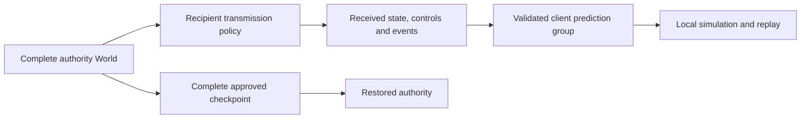

# Recipient views and interest management

Use `Model.replication` to control which state, held inputs and occurrences each
recipient receives. This optional server-side policy filters transmitted data;
the client's `Prediction_Group` separately selects what the client predicts.
The server continues to simulate and archive the complete World.



```odin
model.replication = net.Replication(World, Control, Event, SEATS){
    id = GAME_VIEW_V1,
    project = project_recipient,
    valid = validate_received_replica,
    event = project_recipient_event,
}
```

`project(frame, held, Recipient{seat, spectator})` returns `(Replica{state, held},
ok)`. Remove absent members from active storage and clear their payload, presence
and lifetime fields according to the game's representation. The callback controls
which held inputs are public too; filtering only entity state can still reveal
hidden controls. A recipient has a validated seat or spectator status, never a
client-supplied visibility mask. Store team/visibility permissions in replayable
state if they affect historical decisions.

`valid(replica, recipient)` checks the received representation. It replaces the
complete-world state validator for incoming Welcome/snapshot values. The authority
continues using `Model.state_valid` for its initial world and archives, and all
controls still pass `control_valid`. Before calling `valid`, the server runs
state and held controls through the public replica codec, which zeroes
authority-only schema fields. The validator therefore sees the same
representation as the client decoder.
A rejected projection sends no fallback full state and increments
`Stats.rejected_replica_views`. The affected client may stall or resynchronize
until the authored policy produces a valid view.

`event(frame, recipient, occurrence)` returns `(redacted_event, include)`. It sees
the exact complete authority frame at the event's tick, including when facts are
sent later. Omitted events never enter that recipient's fact packet. Included
occurrences retain their epoch/tick/source/key identities; account for those IDs
when deciding disclosure, and do not encode secrets in event IDs. Event owner
metadata is recomputed from the redacted payload. Other players' action verdicts
are omitted automatically; a player retains its own results and spectators receive
none. Empty fact ticks remain present so confirmation can advance normally.

Callbacks must be pure functions of their supplied values and fixed model policy.
They do not query current scene nodes or mutable side services. Decisions describe
the supplied frame/event tick; they do not retroactively revoke already transmitted
knowledge, hide traffic timing, or prevent inference from intentionally public data.
The framework checks the invariants implemented by the game's validator; it
cannot prove that arbitrary Odin code preserves information-flow restrictions.

## Prediction and presentation

A player using a nonzero replication policy must also supply a nonzero prediction
group. The group's `project` receives the filtered replica. Include every
mutable dependency required by the predicted step/action or use explicit timestamped
boundary values. A received view alone does not establish a closed simulation group.
Existing full-world clients keep their default behavior when replication is disabled.

Authority-only fields can be omitted from a predicting player's wire view when this
explicit policy/group pair is present. The former blanket rejection remains for
unscoped full-world prediction. Observers validate and present their received view
without running player prediction.

`client.authority_frame`, `client_observed` and Godot's authority-state convenience
query mean the **received replica** on a filtered client. They are complete public
worlds only under the default policy. Their historical ticks remain meaningful,
but they cannot be used as complete migration/save archives. Client prediction is
a further projection of that received value.

Membership changes are ordinary value changes in the recipient's snapshot stream.
The existing per-peer acknowledged baselines encode additions/removals and zeroed
payloads. One peer's baseline is never reused for another peer. Dropped deltas,
reconnect serials and authority epochs retain their existing validation boundaries.

## Contracts and recovery

A nonzero policy ID is included in live and archived contract hashes. It names the
authored representation/semantics; code addresses are not hashed. Change it when
changing the policy contract. Peers must use matching IDs. Zero plus nil callbacks
preserves the original contract and behavior, including earlier saves. A partial
policy configuration is invalid.

Authority archives retain complete state, held controls and action ledgers, and
validate with the complete model. Restored authorities project fresh recipient
views; a departing host is sanitized before seeding its client prediction. For
Room, supply a model with the client prediction group even on the original host,
because that same model can be used after a role change. Existing conversion APIs
compute the target policy's contract and do not grant authority to the new bytes.

Gameplay protocol 7 and checkpoint layout 4 are unchanged. The opt-in policy stamp
distinguishes the new capability without changing existing zero-policy contracts.
Normal private-state backup recipient authorization remains required; interest
filtering does not make a full checkpoint safe for untrusted recipients.

## Current scope and evidence

This implementation reuses the authority's fixed State carrier. It reduces repeated
wire changes for omitted objects and filters event traffic, but does not reduce the
carrier's in-memory size or infer sparse storage/dependency domains. Initial full
snapshots retain their fixed schema size. Automatic spatial indexing, alternative
replica types and multiple simulation groups remain separate work.

The fixture uses 32 changing objects, an 80-unit visibility radius, two predicting
players and a fixed-center observer. Player roster/positions are intentionally
public; object payloads outside the view and remote held controls are suppressed.
The wire tap checks current hidden nonce sentinels in Welcome/full/delta/fact
packets, while decoded views and historical facts are also validated. Six core
checks cover movement across regions, reconnect, complete archive recovery,
contract mismatch, invalid projection refusal and departing-host sanitization.

In its fixed 180-tick observer workload, the filtered stream uses 33,282 bytes versus
69,360 for the full public observer (about 52% less). This includes fixture protocol
traffic; it is not a general game bandwidth or CPU claim. Real Godot/ENet peers pass
under configured latency, jitter, unreliable loss and duplication. See the
[retained evidence](../../docs/replay/results/recipient-views-2026-09-07/README.md).
