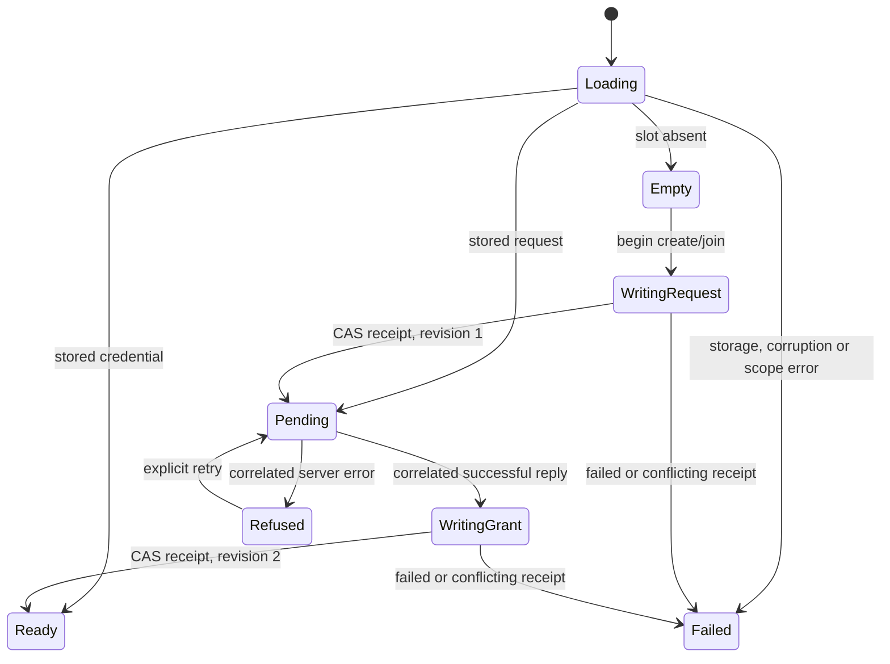

# Durable client enrollment

Create/join now has a client-side journal that persists the exact request before
it can be sent, and persists a successful credential before it can be used. Its
native SQLite and browser IndexedDB drivers use compare-and-swap, so another
process/tab cannot silently replace the identity in the same slot.

`Enrollment_Journal` owns the state machine and canonical codec without depending
on Godot, a network or storage. `replay/godot.Enrollment_Profile` drives storage;
`provision_enrollment_frame` connects the durable pending state to the existing
verified-TLS provisioning connection. This is separate from gameplay saves,
display names, authority bundles and migration checkpoints.

## State and crash behavior



`enrollment_request` returns nothing before the request write's receipt.
`enrollment_grant` returns nothing until the credential write's receipt. A storage
failure preserves the previous in-memory record, clears staged buffers and stops
the owner. It does not assume that a missing acknowledgement proves the storage
transaction failed. Reopen the slot to resolve that uncertainty.

If the game dies after storing a request but before sending it, the next process
loads exactly the same room ID, endpoint and retry claim. If the server commits
enrollment but the game dies before storing its grant, the next process repeats
that request and receives the same credential. A ready slot loads directly without
another enrollment request. The game still performs Room's challenged process
registration; a stored credential is not a live authority lease.

The slot is immutable: absent → pending (revision 1) → ready (revision 2). It
cannot become another identity or service. Both a competing initial creator and a
stale grant writer fail with `Conflict`; neither receives usable state from its
failed write. A fresh owner can then load the winner. There is no automatic
read-latest-and-overwrite path, deletion, account reset or credential retirement.

The server URL and game content ID must exactly match the slot. No URL alias or
redirect silently moves a credential to a different service. Unreadable, malformed,
wrong-content and wrong-scope records are retained and rejected. Server refusal
retains the durable request in `Refused`; `enrollment_retry` explicitly retries it.
Closing and reopening also reloads that pending request. Permanent refusals need
an application decision about choosing another slot or retiring the failed attempt.

## Godot integration

Open `Enrollment_Profile` with a service URL, content, namespace and key. Browser
reads are asynchronous. Native storage is an explicitly supplied
`Enrollment_Backing`, avoiding a SQLite dependency for every Replay/Godot user.
The optional `replay/godot/provision_sqlite.backing` borrows a native, already-open
`provision/sqlite.Client_Store`. That store selects the native file and slot; its
lifetime must exceed the profile's. Browser namespace/key select the IndexedDB slot.

When an empty slot is ready, generate a cryptographic claim and construct a Create
or Join request. The creator must also choose and retain a nonzero room ID; a guest
uses the room/invite secret it was given. Submit with `enrollment_profile_begin`.
The journal stages it; `enrollment_profile_frame` performs the storage operation.

Open the matching `Provision_Connection` and call `provision_enrollment_frame` each
frame. It pumps storage, submits only the durably pending request, handles its
correlated reply, and writes the credential. It checks the connection's exact
service URL before sending. A connection carrying an unrelated pending/completed
request is rejected. Transport errors/timeouts leave the durable enrollment intact.

```odin
profile: rgd.Enrollment_Profile
connection: rgd.Provision_Connection
// Native: obtain backing from a slot/content-scoped Client_Store first.
ok := rgd.enrollment_profile_open(&profile, service_url, game_content,
                                  "my-game", "active-room", native_backing)
// Wait for Loading to complete. Ready can immediately resume with its grant.
// Empty: construct a fresh create/join request, then stage it.
ok = rgd.enrollment_profile_begin(&profile, request)
err := rgd.provision_connect(&connection, service_url)
// In _process, while enrollment is pending:
err = rgd.provision_enrollment_frame(&connection, &profile)
grant, ready := provision.enrollment_grant(&profile.value)
// Only ready grants go to room_with_grant / room_open.
rgd.provision_disconnect(&connection)
rgd.enrollment_profile_close(&profile)
// Close the native backing after closing the profile.
```

Check errors and phases at each step; the example abbreviates the menu controller.
Reading a ready slot does not require opening a connection. The local-development
WS opt-in must be explicit at both profile and connection. The default URL policy
requires WSS, and the connection verifies TLS. On native, `provision.secret` supplies
cryptographic claims. Browser callers can use Godot's cryptographic random-byte
API; the test fixture checks its exact output length and rejects an empty result.

## Storage contract and supported platforms

The client record is version 1, kind `0x5043`, envelope epoch 1, revision in tick,
and game content in content. It contains a bounded canonical service URL, the exact
Create/Join request, pending/ready state and that member's grant. Maximum encoded
storage is 4096 bytes. State/revision, request shape, URL tail, content and credential
shape are validated when loading. It contains no shared authority state.

The native SQLite adapter is currently **macOS/Linux**. It uses a separate client
file/table with the existing checked private-file, WAL/FULL/fullfsync setup. New
files are private; missing creation is explicit, and the containing directory and
backups remain the deployment/application's responsibility. Reads and transitions
run under a revision CAS transaction. Other native platforms need an appropriate
`Enrollment_Backing`; the API does not silently substitute an unsafe writer.

The browser adapter uses the existing bounded IndexedDB operations and their
transaction completion receipts. It compares the stored revision with the record's
own canonical revision and preserves abort/conflict outcomes. Browser data belongs
to the application origin/profile; changing origin is not automatic identity
transfer. Native and browser records hold bearer credentials in private application
storage, not encrypted vaults. Do not log, export or include them in game archives.

## Evidence and remaining work

The [enrollment gate](../../docs/replay/results/client-enrollment-2026-09-07/README.md)
covers pure state/codec/transition rules, SQLite reopen/races/failures, native TLS
client kills at three boundaries, actual Chrome kills, an aborted IndexedDB grant
write, competing tabs and corrupt-record preservation. Native uses verified TLS;
the browser fixture explicitly opts into loopback WS. Public browser TLS deployment
remains a separate gate.

Cavecrawl and Scrapyard now use the shared [Party API](../godot/party.md) with this
flow and a separate CAS recent-room reference. Their fixed co-op invitation is
reproducible from the persisted creator claim and scoped request inputs, so issuance
retries survive restart without a separate generated-secret record. Other game
menus, profile retirement, account/device transfer, additional native storage
platforms and public deployment remain work. Only Create/Join enrollment is
journaled here; general Invite/Revoke intent and rotation workflows still need
their own durable operation records.
