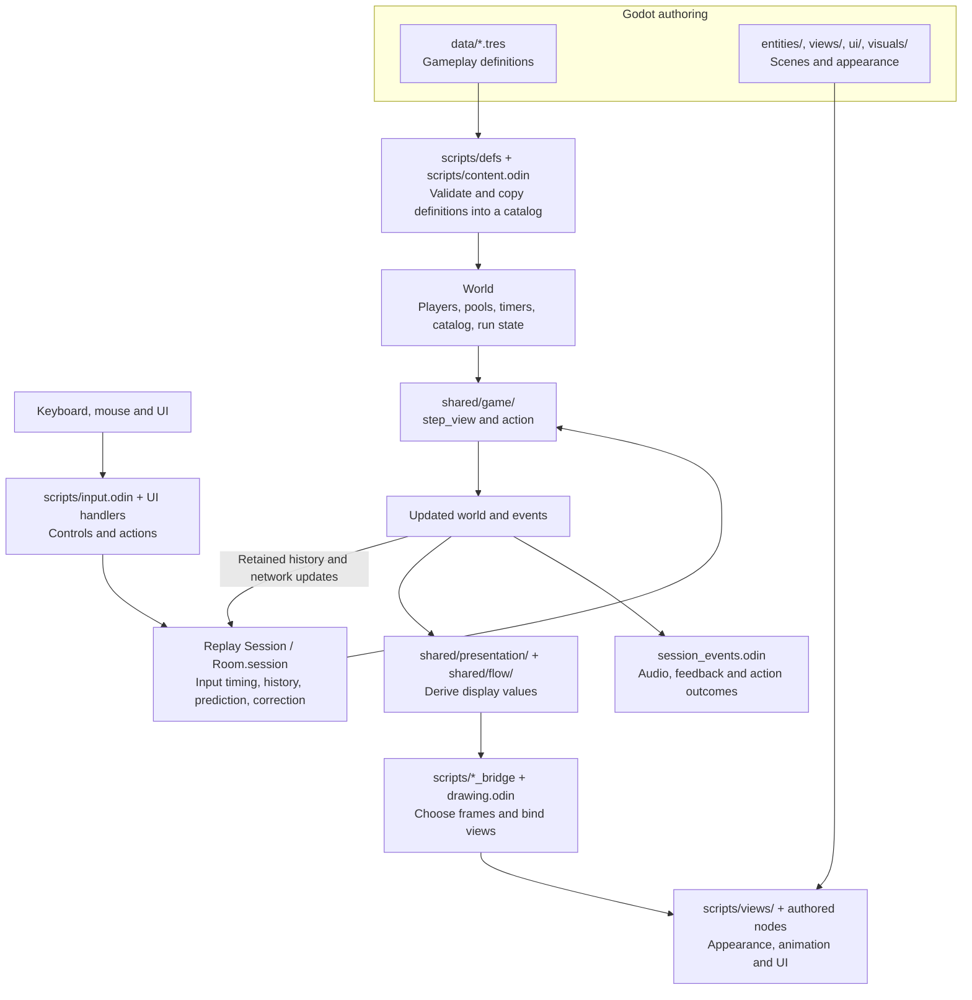
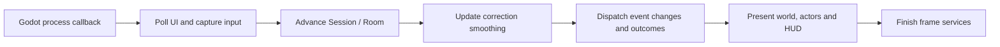

# Start here: contributing to Replay Scrapyard

Scrapyard has three main pieces: **authored Godot content**, **replayable gameplay
state and rules**, and **a Godot adapter that turns input into requests and state
into scenes**. Learn one feature across those boundaries before trying to read
every subsystem. The shared turret is a compact, complete example.

This guide describes the current Replay game. The sibling original Scrapyard and
Kit remain separate. For a file-by-file reference, use the [code guide](code-guide.md).

## 1. Play it, then open a workbench

Run commands from the repository root, `odin_godot`. The repository's
[setup instructions](../../README.md) cover the development environment.

```sh
# Build and launch the game.
nix develop --command bash examples/replay_scrapyard/play.sh

# Or use the quiet turret encounter.
RSY_RUN=0 RSY_ENCOUNTER=turret \
  nix develop --command bash examples/replay_scrapyard/play.sh
```

Choose Solo, select the shared turret in an ability slot, then Ready/Start.
WASD moves, Q/E casts, T mounts/releases a nearby turret, and the mouse aims/fires.
Run and turret rules are described in [run.md](run.md) and
[shared-turret.md](shared-turret.md).

For the editor on macOS, enter the development shell and build first:

```sh
nix develop
bash build/build_scripts.sh examples/replay_scrapyard
ODIN_SCRIPTS_DLL="$PWD/examples/replay_scrapyard/bin/libodinscripts.dylib" \
  "$GODOT" --editor --path examples/replay_scrapyard
```

On Linux, use `libodinscripts.so` and set `GODOT` to your engine executable if the
environment has not supplied it.

Open [dev/turret_workbench.tscn](dev/turret_workbench.tscn), press F6, then choose
**Run isolated encounter**. This equips and casts through the real game. For
visual editing without a network session, use
[dev/enemy_view.tscn](dev/enemy_view.tscn),
[dev/runner_view.tscn](dev/runner_view.tscn), or
[dev/hud_view.tscn](dev/hud_view.tscn).

## 2. The architecture at a glance



The simulation contains values and calls ordinary Odin procedures. With the same
starting state, tick context and admitted inputs, it can reproduce the same result.
Replay retains history and reruns the rules when correction requires it. Godot
objects are reconstructed or updated from those results.

Scrapyard currently chooses authority with client prediction and observed remote
presentation. It is one use of Replay, not a claim that every multiplayer game
must choose this networking policy. The policy wiring is in
[`game.model()`](shared/game/game.odin),
[replication.odin](shared/game/replication.odin), and
[succession.odin](shared/game/succession.odin).

Common import aliases are `r` for Replay's core value/timeline tools, `net` for
network simulation, `rgd` for the Godot integration, `game` for this game's rules,
and `display` for detached presentation values. Files with the same Odin package
share procedures; splitting a file does not introduce a new service or object.

## 3. Know who owns each value

| Question | Owner | Example |
| --- | --- | --- |
| How many bullets should a new turret have? | Authored definition, copied into `World.catalog` | [shared_turret.tres](data/deployables/shared_turret.tres) |
| How many bullets remain, and who is operating it? | Replayable simulation state | `Turret.ammo` and `Turret.operator` in [turret.odin](shared/game/turret.odin) |
| What should the ammo label display? | A derived display value | `Turret_View` in [presentation/turrets.odin](shared/presentation/turrets.odin) |
| Where is that label placed? | An authored scene | [entities/turret.tscn](entities/turret.tscn) |
| How does the barrel turn or the body change color? | Local view behavior | [scripts/views/turret.odin](scripts/views/turret.odin) |
| Which scene instance belongs to this turret? | The view adapter, using a generation-checked handle | [turret_bridge.odin](scripts/turret_bridge.odin) |

Use `World` for values needed to reproduce gameplay: health, occupancy, cooldowns,
entity lifetimes, progression and similar rules. Scene references, textures,
smoothing and animation state belong in the adapter or view. Local settings and
profile persistence have their own services; every local preference need not be
part of the multiplayer world.

Godot composition still applies. A runner has authored Body, Gun, Reload, Beacon
and Nameplate children; a view script can delegate to child components. Gameplay
composition uses state fields and ordinary procedures. The two compositions meet
at explicit display values. See the [editor-first guide](editor-first.md).

In this game, movement collision and hit judgment run in Odin. Moving an enemy's
Body child in the editor changes its visual offset; its gameplay position and
collision radius still come from the simulation. Attaching another visual child
does not automatically create a new replicated entity.

The `//gd:class` declarations, `gd:"export"`/`gd:"onready"` field tags and
`@(gd_method)` annotations connect authored Odin scripts to Godot. A
`//gd:replay_view` declaration generates the typed binding for a view's explicit
presentation/validation hooks. Read the authored scripts and their callbacks;
the generated registration code is infrastructure.

Definition Resources are copied into the admitted catalog. Changing a Resource
does not retroactively change an existing run's catalog. Start a new encounter to
admit the new settings. The editor's bake command also updates the stock artifact
used by headless tests; it uses the same typed extractor.

## 4. Two clocks, and three views of the world

Godot's `_process` callback runs at display-frame cadence. Replay's simulation
runs at 60 ticks per second in this game. Advancing one display frame can run
multiple ticks, or none. Gameplay timers use ticks; visual interpolation and
animation can use frame `dt`.



Read [`replay_scrapyard_process`](scripts/scrapyard.odin), then follow its helpers
in [frame.odin](scripts/frame.odin). `finish_frame` is deferred, so its services
also run on early-return paths. Inside a simulation tick,
[`step_view`](shared/game/game.odin) updates roster, upkeep, movement, combat and
run progression. The network model applies admitted actions after that step;
`action` validates the requested gameplay operation. The session owns ordering
and scheduling, so avoid calling an extra simulation step from a view callback.

| State source | Purpose in this game |
| --- | --- |
| Authority state | Confirmed game decisions and the received authoritative baseline; on a client this is the latest available observation, not knowledge of the server's instantaneous present |
| Predicted state | Responsive local movement and actions before their outcomes are fully known |
| Observed/interpolated state | Smooth remote actor and spectator presentation from received frames |

[`drawing.odin`](scripts/drawing.odin) selects these sources. Local runners use
prediction; remote runners use observed poses. Turrets use the shared predicted
world for seated clients and the observed world for spectators. Prediction does
not grant authority: an occupied-turret claim can be refused and corrected.

Events have a separate presentation lifecycle. A speculative effect may begin,
be confirmed, or be cancelled. Follow [session_events.odin](scripts/session_events.odin)
for audio, feedback and action outcomes. Replaying rules must not directly repeat
Godot audio calls or particle creation.

## 5. Follow one feature end to end: the turret

Read these files in order. Each answers a different question:

1. [data/abilities/turret.tres](data/abilities/turret.tres) and
   [data/deployables/shared_turret.tres](data/deployables/shared_turret.tres):
   what is configurable?
2. [abilities.odin](shared/game/abilities.odin) and
   [ability_casts.odin](shared/game/ability_casts.odin): how is the cast admitted,
   dispatched by family and charged a cooldown?
3. [turret.odin](shared/game/turret.odin): what state exists, and what makes deploy,
   mount, release, fire and cleanup valid?
4. [input.odin](scripts/input.odin) and
   [turret_bridge.odin](scripts/turret_bridge.odin): how does T capture a target
   and submit a reliable mount/release intent?
5. [presentation/turrets.odin](shared/presentation/turrets.odin): how is gameplay
   state converted into the values needed for display?
6. [entities/turret.tscn](entities/turret.tscn) and
   [views/turret.odin](scripts/views/turret.odin): how do composed nodes show those
   values?
7. [turret tests](../../tests/replay_turret/model/turret_test.odin): what behavior
   must survive contention, correction, stale handles and recovery?

```mermaid
sequenceDiagram
    participant Player
    participant Input as Input / turret bridge
    participant Replay as Replay session
    participant Game as Game rules / World
    participant View as Turret scene
    Player->>Input: Press T near a turret
    Input->>Replay: Mount action with turret handle
    Replay->>Game: Apply action at its assigned tick
    Game->>Game: Check target generation, range and occupancy
    Game-->>Replay: Accepted or refused; resulting state
    Replay-->>View: Present predicted/observed turret values
    Player->>Input: Hold fire
    Input->>Replay: Sample fire control
    Replay->>Game: Advance subsequent simulation ticks
    Game->>Game: Insert shot; spend ammo; remove turret at zero
    Replay-->>View: Update or retire the turret view
```

Occupancy lives in the turret. Removing the turret therefore releases its operator
without a second mounted flag to synchronize. A pool handle includes an index
and generation: an old request cannot target a new turret that reused the slot.
The adapter follows that identity and the current view scope to manage nodes.

The complete feature guide is [shared-turret.md](shared-turret.md). For a second
example centered on enemy behavior and composed animation, read
[Stormcaller](stormcaller.md).

## 6. Choose a first contribution

| Change | Start here | Check it with |
| --- | --- | --- |
| Adjust HUD layout or an actor's visual offsets | `ui/`, `entities/`, `views/components/`, `visuals/` | The matching F6 view preview |
| Tune turret ammunition or an ability's radius | `data/`, Inspector Resource fields | Validate Content, then a fresh ability workbench encounter |
| Change an ability effect | `shared/game/ability_casts.odin` and its admission in `abilities.odin` | Focused model tests, then an encounter |
| Change enemy behavior | `shared/game/brains.odin` or `pulse.odin` | Brain/model tests and a live workbench enemy |
| Change input or lobby interaction | `scripts/input.odin`, `muster.odin`, `lobby_actions.odin` | Godot input/lobby checks and real peers |
| Add a new saved component or action | State and validation in `shared/game/`; authoring/display as needed | Correction, checkpoint continuation and explicit compatibility work |

A useful first exercise is to move the turret's Ammo label in its scene, run the
workbench, and observe that only presentation changed. Then tune its authored
ammo, validate, start a fresh encounter, and inspect how the catalog supplies
that value to a newly deployed turret. Restore exploratory edits when finished.

For a new gameplay feature, follow the [editor workflow](editor-workflow.md) and
[authoring tools guide](authoring-tools.md). Changes to serialized shapes or rule
contracts need deliberate version/conversion handling; [saves.md](saves.md)
explains the existing policy. Generated `*.gen.odin` bindings are build outputs.

## 7. Run the smallest relevant check, then expand

These commands run from the repository root:

```sh
# Pure game tests: no Godot window or network service.
nix develop --command odin test tests/replay_scrapyard \
  -collection:godot=. -out:/tmp/replay-scrapyard-model-tests

# Focused turret model tests.
nix develop --command odin test tests/replay_turret/model \
  -collection:godot=. -out:/tmp/replay-turret-model-tests

# Full turret exercise: native/WASM, workbench, real peers and host recovery.
nix develop --command bash tests/replay_turret/run.sh

# Formatting and authored stock consistency.
nix develop --command python3 examples/replay_scrapyard/tools/format.py --check
python3 examples/replay_scrapyard/tools/stock.py --check
```

The existing [test guide](../../tests/replay_turret/README.md) describes the turret
fixtures. The [code guide](code-guide.md) records recent refactor verification.
For appearance changes, run the affected scene; for changed input paths, use real
Godot input; for saved gameplay state, check correction and checkpoint recovery.

## 8. Deeper reading when a task needs it

| Topic | Guide |
| --- | --- |
| Everyday code navigation and formatting | [Code guide](code-guide.md) |
| Godot scenes versus simulation composition | [Editor-first guide](editor-first.md) |
| Inspector validation, baking and reproducible workbench tests | [Editor workflow](editor-workflow.md) |
| Held controls, discrete actions and receipt timing | [Controls](controls.md) |
| Combat and run progression | [Combat](combat.md), [Run rules](run.md) |
| Coordinated rooms and host recovery | [Online](online.md), [Recovery](recovery.md) |
| Save compatibility | [Saves](saves.md) |

A `Session` runs a simulation with network input/history. A `Room` adds coordinated
membership and authority recovery around a session. Those details matter when
working on joining, persistence or migration; an initial gameplay or visual task
can follow the feature path above without reading the transport implementation.
